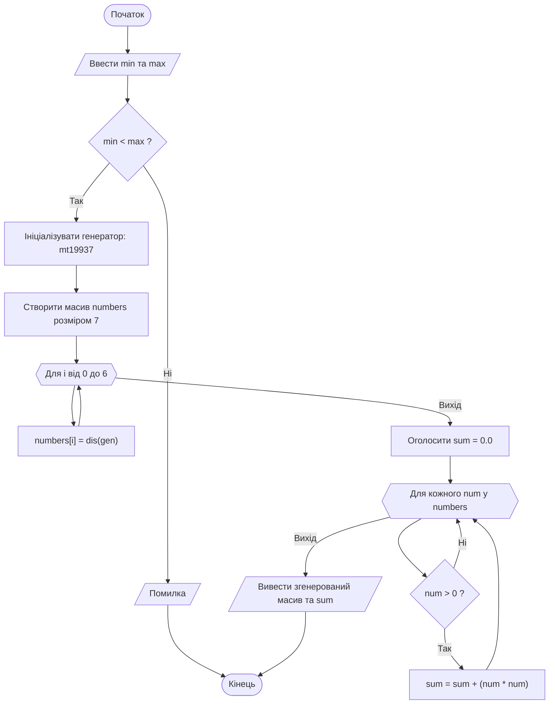
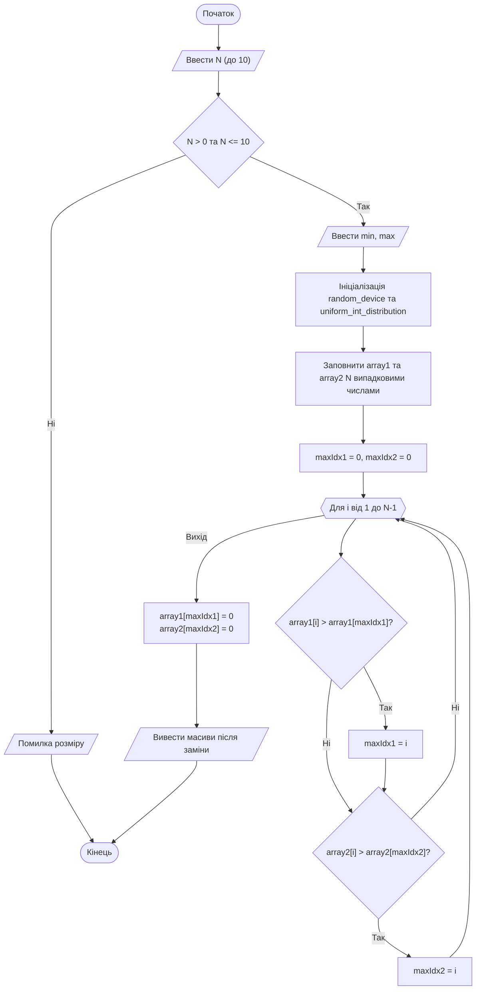

# Лабораторна робота №5. Одновимірні масиви. Генерування випадкових чисел та розширені операції

## Мета роботи

Закріплення навичок роботи з одновимірними масивами, реалізація алгоритмів пошуку та модифікації елементів масивів; ознайомлення з методами генерування випадкових чисел у C++; знайомство з сучасними можливостями стандарту C++11 (зокрема, з діапазонним циклом `for` та бібліотекою `<random>`).

## Задачі роботи

1. Опанувати способи генерування псевдовипадкових чисел (класичний C-style спосіб та сучасний, з використанням бібліотеки `<random>`).
2. Дослідити нові способи перебору масивів, такі як діапазонний цикл `for` (range-based `for` loop).
3. Скласти блок-схеми алгоритмів і написати програми із застосуванням одновимірних масивів для розв'язання завдань відповідно до індивідуального варіанта.
4. Оформити результати у вигляді звіту з наведенням схем алгоритмів, лістингів коду та результатів тестування.

## Перелік індивідуальних варіантів завдання

Лабораторна робота містить завдання двох рівнів складності. Номер індивідуального варіанта завдання призначається викладачем.

### Таблиця 1 — Базовий рівень

| № | Розмір масиву | Тип даних | Індивідуальне завдання |
| :--- | :--- | :--- | :--- |
| 1 | 15 | цілий | Обчислити кількість та суму парних елементів масиву |
| 2 | 10 | цілий | Обчислити середнє арифметичне додатних елементів |
| 3 | 8 | цілий | Обчислити факторіал значення останнього елемента |
| 4 | 12 | дійсний | Обчислити добуток елементів, значення яких менше 6-ти |
| 5 | 14 | цілий | Обчислити середнє арифметичне непарних елементів |
| 6 | 18 | дійсний | Впорядкувати за спаданням першу половину масиву |
| 7 | 11 | цілий | Розмістити елементи масиву у зворотному порядку |
| 8 | 14 | дійсний | Розмістити елементи масиву у порядку зростання значень їх модулів |
| 9 | 16 | цілий | Обчислити суму елементів масиву, кратних 3 |
| 10 | 14 | дійсний | Обчислити суму елементів, абсолютне значення яких не перевищує 10 |
| 11 | 17 | цілий | Обчислити середнє арифметичне мінімального та максимального елементів масиву |
| 12 | 9 | дійсний | Вивести кількість елементів, значення яких більше за значення першого елемента масиву |
| 13 | 15 | цілий | Визначити індекси мінімального і максимального елементів масиву |
| 14 | 10 | дійсний | Обчислити суму елементів масиву, значення яких належать проміжку [3, 6] |
| 15 | 8 | цілий | Обчислити добуток непарних елементів масиву |
| 16 | 12 | дійсний | Визначити номери мінімального і максимального елементів масиву |
| 17 | 20 | цілий | Впорядкувати за зростанням другу половину масиву |
| 18 | 18 | цілий | Обчислити середнє арифметичне елементів, значення яких більше значення останнього елемента масиву |
| 19 | 11 | дійсний | Обчислити кількість додатних елементів, значення яких менше 20-ти |
| 20 | 9 | дійсний | Обчислити модуль суми всіх від'ємних елементів, суму всіх додатних і різницю між значеннями цих сум |
| 21 | 16 | цілий | Обчислити середнє арифметичне елементів, кратних 5 |
| 22 | 19 | дійсний | Визначити мінімальний із додатних елементів |
| 23 | 17 | цілий | Обчислити кількість додатних, від'ємних і нульових елементів |
| 24 | 8 | дійсний | Обчислити добуток одноцифрових елементів масиву |
| 25 | 7 | дійсний | Обчислити суму тільки двоцифрових елементів |
| 26 | 18 | дійсний | Визначити максимальний і мінімальний елементи, наскільки максимальний елемент є більшим за мінімальний |
| 27 | 11 | цілий | Обчислити відсотковий вміст додатних, від'ємних і нульових елементів |
| 28 | 10 | дійсний | Обчислити суму квадратів тих чисел, модуль яких більше значення 2.5 |
| 29 | 12 | дійсний | Визначити найбільший з парних додатних елементів |
| 30 | 9 | дійсний | Обчислити суму модулів усіх від'ємних елементів масиву |

### Таблиця 2 — Середній рівень (Динамічний аналіз та зв'язки між елементами)

> **Примітка:** У цій таблиці розмірність масивів вказується як "до $N$". Точне значення розмірності визначається користувачем під час виконання програми.

| № | Розмір масиву | Тип даних | Індивідуальне завдання |
| :--- | :--- | :--- | :--- |
| 1 | до 9 | цілий | Ввести два масиви й обчислити кількість однакових елементів у них |
| 2 | до 10 | дійсний | Ввести два масиви і побудувати третій з упорядкованих за зростанням значень елементів обох масивів |
| 3 | до 12 | цілий | Ввести масив, в якому кожний елемент є 0, 1 або 2, переставити елементи масиву так, щоб спочатку були розміщені всі 1, потім всі 0 і, наприкінці, всі 2 |
| 4 | до 8 | дійсний | Ввести масив і число $С$. Переставити числа в масиві так, щоб спочатку були розміщені всі елементи менші за значення $С$, потім більші $С$, зберігаючи порядок їх розміщення |
| 5 | до 14 | цілий | Визначити перше число, яке є присутнім у кожному з 3-х масивів, значення в цих масивах розміщено за зростанням |
| 6 | до 7 | дійсний | Ввести два масиви та створити третій зі спільних елементів масивів |
| 7 | до 11 | цілий | Ввести масив, в якому тільки два однакові елементи. Визначити їхні індекси |
| 8 | до 14 | дійсний | Ввести масив і число $L$. Створити новий масив з елементів, менших за $L$, і впорядкувати новий масив за спаданням |
| 9 | до 19 | цілий | Визначити пару сусідніх елементів масиву, значення яких є найближчими один до одного, тобто значення $X_{i+1} - X_{i}$ є мінімальним |
| 10 | до 12 | дійсний | Обчислити добуток $Р$ від'ємних елементів з парними індексами, які не перевищують введеного числа $L$, і поділити всі додатні елементи на $Р$ |
| 11 | до 17 | цілий | Ввести масив і створити на його основі два нових масиви: перший з елементів з непарними індексами, другий - з елементів, кратних 5 |
| 12 | до 9 | дійсний | Ввести масив і число $Р$. Визначити елемент масиву, значення якого найближче до $Р$, тобто значення $X_{i} - P$ є мінімальним |
| 13 | до 15 | цілий | Впорядкувати масив так, щоб всі додатні числа були розміщені спочатку за зростанням, а всі від'ємні наприкінці за спаданням |
| 14 | до 10 | дійсний | Ввести два масиви і визначити кількість неоднакових елементів у них |
| 15 | до 8 | цілий | Ввести два масиви та замінити нулями ті елементи першого масиву, яких немає у другому |
| 16 | до 12 | дійсний | Обчислити суму від'ємних елементів, які не перевищують заданого числа $L$, і поділити останній додатний елемент на $S$ |
| 17 | до 20 | цілий | Ввести масив і число $К$. Створити два нових масиви: перший з елементів, менших за значення $К$, другий з елементів, більших за $К$, зберігаючи порядок їх розміщення |
| 18 | до 18 | дійсний | Ввести масив, який містить багато нульових елементів. Замінити всі групи підряд розміщених нулів на значення кількості нулів |
| 19 | до 11 | цілий | Обчислити суму $S$ додатних непарних елементів і замінити всі парні елементи масиву на $S$ |
| 20 | до 9 | дійсний | Ввести два масиви, визначити максимальні елементи кожного з них і поміняти їх місцями |
| 21 | до 16 | цілий | Ввести масив і на його основі створити новий з від'ємних і нульових елементів з парними індексами |
| 22 | до 19 | дійсний | Ввести два масиви, визначити мінімальний елемент першого і максимальний елемент другого масиву, і поміняти їх місцями |
| 23 | до 17 | цілий | Ввести масив і на його основі створити два нових масиви: перший з парних елементів, другий з елементів, кратних 3 |
| 24 | до 8 | дійсний | Ввести два масиви і замінити нулями ті елементи другого масиву, які є в першому |
| 25 | до 7 | цілий | Ввести два масиви і поміняти місцями максимальний елемент першого масиву з першим елементом другого, який більше 5-ти |
| 26 | до 18 | дійсний | Ввести масив і на його основі створити новий з додатних елементів, більших за середнє арифметичне всіх елементів |
| 27 | до 15 | цілий | Ввести масив і число $L$. Створити новий масив з елементів, більших за $L$, і впорядкувати створений масив за зростанням |
| 28 | до 10 | дійсний | Визначити пару сусідніх елементів масиву, значення яких максимально різняться один від одного, тобто значення $\vert X_{i+1} - X_{i} \vert$ є максимальним |
| 29 | до 16 | цілий | Ввести масив, який містить багато нульових елементів. Замінити всі групи підряд розміщених нулів на один нуль |
| 30 | до 12 | дійсний | Ввести два масиви, визначити мінімальні елементи кожного з них і поміняти їх місцями |

## Теоретичні відомості

### 1. Способи отримання випадкових чисел у мові C++

У мові C++ є кілька способів генерування випадкових чисел. Вибір методу залежить від умов та складності поставленої задачі.

1. **Класичний спосіб (C-style)**
    Використовуються функції `rand()` і `srand()` з бібліотеки `<cstdlib>`. Ініціалізація генератора відбувається через `srand(time(nullptr))`. Цей спосіб є простим, проте має низьку якість випадковості та складніший механізм масштабування діапазонів.
2. **Сучасний спосіб (C++11)**
    Для генерації випадкових чисел рекомендується використовувати бібліотеку `<random>`. Вона надає потужні та надійні інструменти:
    - `random_device rd;` — клас, який забезпечує доступ до апаратного генератора випадкових чисел (використовується як seed).
    - `mt19937 gen(rd());` — реалізація генератора Mersenne Twister, який є достатньо швидким і має хороші статистичні властивості.
    - `uniform_int_distribution<> dis(min, max);` — забезпечує рівномірний розподіл випадкових цілих чисел у заданому діапазоні.
    - `uniform_real_distribution<> dis(min, max);` — забезпечує рівномірний розподіл випадкових дійсних чисел.

### 2. Діапазонний цикл (Range-based `for` loop)

Діапазонний цикл вигляду `for (тип змінна : контейнер)` був введений у стандарті C++11. Він дозволяє зручно перебирати елементи контейнерів, таких як масиви або вектори, без явної вказівки індексів.

- *Синтаксис*: `for (тип змінна : контейнер)`, де `тип змінна` — це тип елементів контейнера та змінна, яка послідовно на кожній ітерації приймає значення кожного наступного елемента з контейнера, а `контейнер` — це структура даних, по якій здійснюється перебір.
- *Переваги*: робить код більш читабельним, спрощує його та автоматично контролює межі масиву, що зменшує ризик виходу за їхні межі.

### 3. Динамічна розмірність масивів

У класичному C++ розмір статичного масиву має бути відомий на етапі компіляції. Оскільки за умовою розмір $N$ задається користувачем під час виконання програми, використовується контейнер `std::vector` із стандартної бібліотеки шаблонів (STL). Це безпечний та сучасний спосіб організації динамічних масивів.

Він може бути ініціалізований одразу потрібним розміром: `vector<int> array1(n);` та керує виділенням пам'яті автоматично.

Альтернативним способом було б створення масивів через вказівники та оператор `new` (що вимагало б ручного очищення пам'яті через `delete[]`). Але вказівники та їх використання буде розглядатись пізніше.

## Приклад виконання завдання

### 1. Умова завдання

Запросити у користувача діапазон чисел. Згенерувати масив із 7 дійсних чисел у заданому діапазоні. Обчислити суму квадратів усіх додатних елементів масиву.

### 2. Схема алгоритму програми (Mermaid)

Схема алгоритму, виконана за допомогою мови розмітки mermaid:



### 3. Програма на C++

Повна програма, що реалізує завдання.

```cpp
#include <iostream>
#include <random>
#include <windows.h>

using namespace std;

int main() {
    SetConsoleOutputCP(CP_UTF8);

    double min, max;
    cout << "Введіть мінімальне значення діапазону: ";
    cin >> min;
    cout << "Введіть максимальне значення діапазону: ";
    cin >> max;

    if (min >= max) {
        cerr << "Помилка: мінімальне значення повинно бути меншим за максимальне.\n";
        return 1;
    }

    // Ініціалізація сучасного генератора випадкових чисел
    random_device rd;
    mt19937 gen(rd());
    uniform_real_distribution<> dis(min, max);

    const int size = 7;
    double numbers[size];

    // Наповнення масиву
    cout << "Згенерований масив: ";
    for (int i = 0; i < size; ++i) {
        numbers[i] = dis(gen);
        cout << numbers[i] << " ";
    }
    cout << "\n";

    double sum_of_squares = 0.0;
    
    // Використання діапазонного циклу (C++11)
    for (double num : numbers) {
        if (num > 0) {
            sum_of_squares += (num * num);
        }
    }

    cout << "Сума квадратів додатних елементів: " << sum_of_squares << endl;
    return 0;
}
```

### 4. Пояснення принципів роботи програми

Програма запитує межі генерації та створює об'єкти з `<random>` для генерування чисел. Масив заповнюється у звичайному `for`. Для підрахунку суми квадратів застосовано зручний діапазонний цикл `for (double num : numbers)`, який автоматично витягує кожен елемент масиву у змінну num для перевірки її знака.

### 5. Приклад роботи програми в консолі

```cmd
Введіть мінімальне значення діапазону: -5
Введіть максимальне значення діапазону: 10
Згенерований масив: -2.3 4.1 8.5 -1.1 0.5 -4.0 6.2 
Сума квадратів додатних елементів: 127.75
```

### 6. Тестування програми

Для забезпечення надійності та всебічної перевірки алгоритму розроблено набір із таких тестових випадків:

| № тесту | Тип тесту | Вхідні дані | Очікуваний результат | Мета перевірки |
| :---: | :--- | :--- | :--- | :--- |
| 1 | Стандартний (змішані числа) | `min = -10.0`  `max = 10.0` | Згенеровано 7 чисел (як додатні, так і від'ємні). Сума квадратів обчислюється лише для додатних. | Перевірка базової логіки програми та фільтрації чисел за умовою `num > 0`. |
| 2 | Суто додатний діапазон | `min = 2.0` `max = 20.0` | Згенеровано 7 додатних чисел. Сума квадратів обчислюється для всіх 7 елементів масиву. | Перевірка розрахунку, коли всі без винятку згенеровані елементи задовольняють умову. |
| 3 | Суто від'ємний діапазон | `min = -50.0` `max = -5.0` | Згенеровано 7 від'ємних чисел. Виведено результат: `Сума квадратів додатних елементів: 0`. | Перевірка поведінки програми, коли жоден елемент масиву не відповідає умові. |
| 4 | Некоректний діапазон (`min > max`) | `min = 20.0` `max = 10.0` | Виведено повідомлення: `Помилка: мінімальне значення повинно бути меншим за максимальне`. Програма завершує роботу. | Перевірка спрацювання захисту від логічно неправильних меж діапазону. |
| 5 | Рівні межі діапазону (`min == max`) | `min = 5.5` `max = 5.5` | Виведено повідомлення про помилку. Програма завершує роботу (оскільки умова валідації `min >= max`). | Перевірка суворої нерівності умов валідації (генератор вимагає строго `min < max`). |
| 6 | Дробовий діапазон (числа $< 1$) | `min = 0.1` `max = 0.9` | Згенеровано 7 малих дійсних чисел. Сума квадратів коректно обчислюється з урахуванням дробів. | Перевірка роботи генератора `<random>` та арифметичних операцій з малими значеннями типу `double`. |

## Приклад виконання завдання №2

### 1. Умова завдання №2

Ввести кількість елементів $N$ (до 10) та діапазон. Згенерувати два масиви цілих чисел. Знайти максимальні елементи в обох масивах і замінити їхні значення на 0.

### 2. Схема алгоритму програми (Mermaid) для завдання №2

Схема алгоритму, виконана за допомогою мови розмітки mermaid:



### 4. Програма на C++ для завдання №2

```cpp
#include <iostream>
#include <vector>
#include <random>
#include <windows.h>

using namespace std;

int main() {
    SetConsoleOutputCP(CP_UTF8);

    int n, min, max;
    cout << "Введіть розмір масивів N (до 10): ";
    cin >> n;
    
    if (n <= 0 || n > 10) {
        cerr << "Помилка: некоректний розмір!\n";
        return 1;
    }

    cout << "Введіть мінімальне значення діапазону: ";
    cin >> min;
    cout << "Введіть максимальне значення діапазону: ";
    cin >> max;

    if (min >= max) {
        cerr << "Помилка: мінімум має бути меншим за максимум.\n";
        return 1;
    }

    random_device rd;
    mt19937 gen(rd());
    uniform_int_distribution<> dis(min, max);

    // Використання векторів для динамічної розмірності
    vector<int> array1(n);
    vector<int> array2(n);

    cout << "Масив 1: ";
    for (int i = 0; i < n; ++i) {
        array1[i] = dis(gen);
        cout << array1[i] << " ";
    }
    
    cout << "\nМасив 2: ";
    for (int i = 0; i < n; ++i) {
        array2[i] = dis(gen);
        cout << array2[i] << " ";
    }
    cout << "\n";

    // Пошук індексів максимальних елементів
    int maxIdx1 = 0, maxIdx2 = 0;
    for (int i = 1; i < n; ++i) {
        if (array1[i] > array1[maxIdx1]) {
            maxIdx1 = i;
        }
        if (array2[i] > array2[maxIdx2]) {
            maxIdx2 = i;
        }
    }

    cout << "\nМаксимальний елемент масиву 1: " << array1[maxIdx1] << " (індекс " << maxIdx1 << ")\n";
    cout << "Максимальний елемент масиву 2: " << array2[maxIdx2] << " (індекс " << maxIdx2 << ")\n";

    // Заміна на нуль
    array1[maxIdx1] = 0;
    array2[maxIdx2] = 0;

    cout << "\nМасив 1 після заміни: ";
    for (int num : array1) cout << num << " ";
    
    cout << "\nМасив 2 після заміни: ";
    for (int num : array2) cout << num << " ";
    cout << endl;

    return 0;
}
```

### 5. Пояснення принципів роботи програми для завдання №2

1. Оскільки розмірність вказується користувачем (до 10), замість статичних масивів використовується `std::vector`, що є сучасним еквівалентом динамічних масивів у C++. Під час пошуку максимальних значень ми запам'ятовуємо саме їхні індекси (`maxIdx1`, `maxIdx2`), оскільки це дозволяє після завершення циклу звернутися напряму до відповідної комірки масиву та присвоїти їй 0.
2. Блок введення та перевірок: програма починає роботу із запиту розміру $N$. Якщо введено число `<= 0` або `> 10`, виконання переривається з кодом помилки 1. Аналогічна перевірка виконується для меж діапазону випадкових чисел (`min < max`).
3. Ініціалізація генератора: створюються об'єкти `random_device` (джерело ентропії) та `mt19937` (сам генератор), після чого налаштовується рівномірний цілочисельний розподіл `dis(min, max)`.
4. Генерація масивів: у двох циклах `for` вектори `array1` та `array2` заповнюються випадковими значеннями `dis(gen)`, які одразу виводяться на екран для наочності.
5. Алгоритм пошуку: у єдиному циклі, що починається з індексу 1 (оскільки 0-й індекс ми беремо за початковий еталон), відбувається паралельний пошук максимумів для обох масивів. Якщо поточний елемент більший за тимчасовий максимум, його індекс записується у `maxIdx1` або `maxIdx2`.
6. Модифікація та виведення: за знайденими індексами виконується пряме присвоєння `array1[maxIdx1] = 0;` та `array2[maxIdx2] = 0;`. Змінені масиви виводяться за допомогою лаконічного діапазонного циклу `for (int num : array1)`.

### 6. Приклад роботи програми в консолі для завдання №2

```cmd
Введіть розмір масивів N (до 10): 5
Введіть мінімальне значення діапазону: -10
Введіть максимальне значення діапазону: 50
Масив 1: 12 45 -3 21 8 
Масив 2: 5 -8 30 11 30 

Максимальний елемент масиву 1: 45 (індекс 1)
Максимальний елемент масиву 2: 30 (індекс 2)

Масив 1 після заміни: 12 0 -3 21 8 
Масив 2 після заміни: 5 -8 0 11 30
```

### 7. Тестування програми для завдання №2

| № тесту | Тип тесту | Вхідні дані | Очікуваний результат | Мета перевірки |
| :---: | :--- | :--- | :--- | :--- |
| 1 | Типовий випадок | `N = 5`, `min = 10`, `max = 50` | Згенеровано 2 масиви по 5 цілих чисел. Знайдено максимуми в обох масивах, виведено їхні індекси, а самі значення замінено на `0`. | Перевірка базової логіки програми: заповнення векторів, пошук максимумів та їх успішна модифікація. |
| 2 | Максимально дозволений розмір | `N = 10`, `min = -100`, `max = 100` | Згенеровано 2 масиви по 10 елементів. Максимальні елементи коректно знайдені та замінені нулями. | Перевірка безпомилкової роботи програми на верхній дозволеній межі розмірності (до 10 включно). |
| 3 | Мінімально дозволений розмір | `N = 1`, `min = 1`, `max = 5` | Згенеровано 2 масиви по 1 елементу. Цей єдиний елемент в обох масивах коректно визначається як максимальний і стає `0`. | Перевірка стабільності алгоритму пошуку екстремумів на гранично малому масиві, що складається лише з одного елемента. |
| 4 | Некоректний розмір (більше ліміту) | `N = 12` | Виведено повідомлення: `Помилка: некоректний розмір!`. Програма негайно завершує роботу. | Перевірка спрацювання захисту від введення розмірності, яка перевищує встановлене обмеження. |
| 5 | Некоректний розмір (нуль або від'ємний) | `N = 0` (або `N = -3`) | Виведено повідомлення: `Помилка: некоректний розмір!`. Програма негайно завершує роботу. | Перевірка стійкості програми до некоректних (нульових або від'ємних) значень розмірності. |
| 6 | Некоректний діапазон (`min >= max`) | `N = 5`, `min = 30`, `max = 10` | Виведено повідомлення: `Помилка: мінімум має бути меншим за максимум.`. Програма завершує роботу. | Перевірка спрацювання валідації логіки діапазону випадкових чисел перед ініціалізацією генератора. |
| 7 | Суто від'ємні значення | `N = 6`, `min = -50`, `max = -5` | Згенеровано 2 масиви виключно з від'ємних чисел. Максимуми (значення, найближчі до нуля) визначені правильно та замінені на `0`. | Перевірка коректності пошуку максимального елемента в ситуації, коли всі згенеровані числа є від'ємними. |

## Вимоги до звіту

За результатами виконання індивідуального варіанта завдання треба підготувати звіт, складений за встановленим шаблоном.

**Структура звіту:**

1. Титульний аркуш із зазначенням назви дисципліни, номера лабораторної роботи та її теми, навчальної групи та ПІБ студента.
2. Текст завдання відповідно до призначеного індивідуального варіанта (з точним описом умов та обмежень).
3. Теоретичні відомості та опис способу вирішення завдання:
    - обраний тип генератора
    - оптимальність обробки масивів
    - формати використаних конструкцій циклів
4. Схема алгоритму програми, оформлена відповідно до стандартів (блок-схема) у графічному вигляді, або згенерована за допомогою мови опису діаграм Mermaid (код, що описує діаграму, теж треба додати у звіт).
5. Текст програми (лістинг коду). Обов'язкове оформлення моноширинним шрифтом (*Courier New*, *Consolas*, *Lucida Console* тощо). Наявність коментарів у ключових блоках коду (ініціалізація, цикл, логічні перевірки).
6. Перелік тестових випадків та результати їх виконання:
    - таблиця тестових наборів (не менше 5 варіантів, включаючи типові, межові та помилкові дані);
    - копії вікна командного рядка (знімки екрана / скріншоти) з реальними результатами запуску програми для кожного тесту.
7. Висновки (бажано), підсумок щодо досягнення мети роботи, особливості функціонування розробленої програми, виявлені обмеження або потенційні шляхи покращення.
