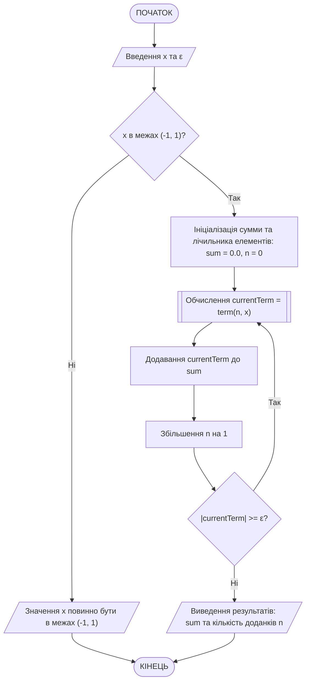
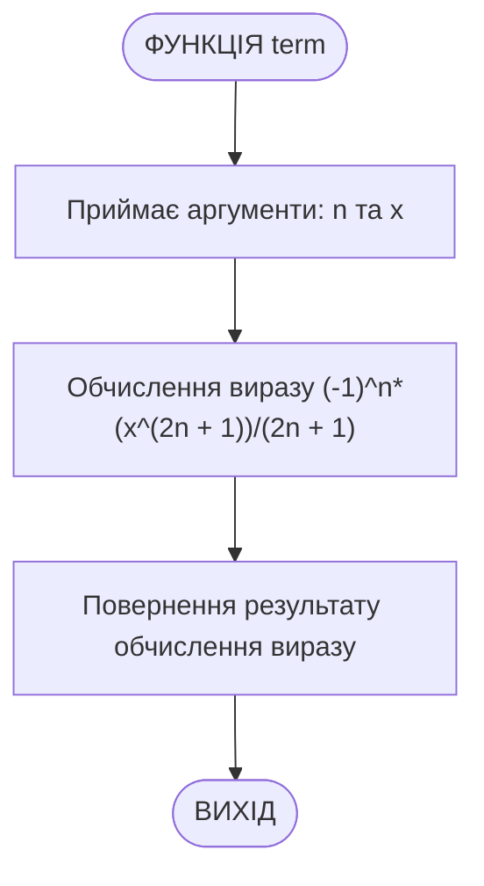
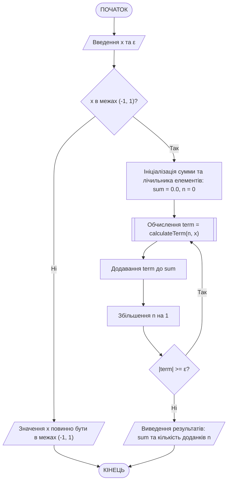
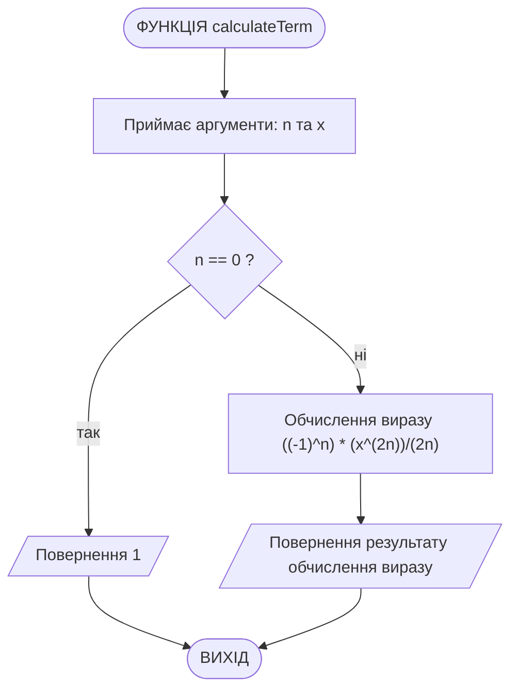

# Лабораторна робота №6. Цикли з невизначеною кількістю ітерацій та використання підпрограм

## Мета роботи

Закріплення навичок роботи з циклами з заздалегідь невизначеною кількістю ітерацій (`while`, `do-while`); реалізація алгоритмів обчислення суми нескінченних числових послідовностей із заданою точністю; ознайомлення з принципами декомпозиції коду та створення користувацьких функцій у мові C++.

## Задачі роботи

1. Опанувати способи організації циклів, де кількість повторень заздалегідь невідома і залежить від виконання певної умови (наприклад, досягнення заданої точності $\varepsilon$ обчислення суми послідовності, що зходиться).
2. Навчитися виділяти логічні блоки коду в окремі підпрограми (функції) та передавати в них аргументи.
3. Скласти блок-схему алгоритму і написати програму для обчислення суми ряду відповідно до індивідуального варіанта.
4. Оформити результати у вигляді звіту з наведенням схем алгоритмів, лістингів коду та результатів тестування.

## Перелік індивідуальних варіантів завдання

Загальна умова для всіх варіантів: ввести значення $x$ на діапазоні $-1 < x < 1$ та точність обчислення $\varepsilon$. Обчислити та вивести на екран суму ряду із заданою точністю $\varepsilon$. Визначити кількість доданків. Кожен член ряду обчислити як функцію. Послідовність обрати за варіантами:

### Таблиця 1 — Перелік індивідуальних варіантів

| № | Послідовність (формула ряду) |
| --- | --- |
| 1 | $x-\frac{x^{2}}{2}+\frac{x^{3}}{3}-\frac{x^{4}}{4}+\frac{x^{5}}{5}-...$ |
| 2 | $x-\frac{x^{2}}{\sqrt{2}}+\frac{x^{3}}{\sqrt{3}}-\frac{x^{4}}{2}+\frac{x^{5}}{\sqrt{5}}-...$ |
| 3 | $1-x+\frac{x^{2}}{2!}-\frac{x^{3}}{3!}+\frac{x^{4}}{4!}-\frac{x^{5}}{5!}+...$ |
| 4 | $1-\frac{x^{2}}{2!}+\frac{x^{4}}{4!}-\frac{x^{6}}{6!}+\frac{x^{8}}{8!}-...$ |
| 5 | $1-\frac{x^{3}}{3!}+\frac{x^{5}}{5!}-\frac{x^{7}}{7!}+\frac{x^{9}}{9!}-...$ |
| 6 | $x-\frac{1}{2}\cdot\frac{x^{3}}{3}+\frac{1\cdot3}{2\cdot4}\cdot\frac{x^{5}}{5}-\frac{1\cdot3\cdot5}{2\cdot4\cdot6}\cdot\frac{x^{7}}{7}+...$ |
| 7 | $1-2x^{2}+3x^{3}-4x^{4}+5x^{5}-6x^{6}+...$ |
| 8 | $x-\frac{x^{2}}{2^{2}}+\frac{x^{3}}{3^{2}}-\frac{x^{4}}{4^{2}}+\frac{x^{5}}{5^{2}}-\frac{x^{6}}{6^{2}}+...$ |
| 9 | $1-2x+\frac{3x^{2}}{2!}-\frac{4x^{3}}{3!}+\frac{5x^{4}}{4!}-\frac{6x^{5}}{5!}+...$ |
| 10 | $\frac{x}{1\cdot2^{2}}-\frac{x^{2}}{2\cdot3^{2}}+\frac{x^{3}}{3\cdot4^{2}}-\frac{x^{4}}{4\cdot5^{2}}+\frac{x^{5}}{5\cdot6^{2}}-...$ |
| 11 | $1-\frac{1}{2}\cdot x^{2}+\frac{1\cdot3}{2\cdot4}\cdot x^{4}-\frac{1\cdot3\cdot5}{2\cdot4\cdot6}\cdot x^{6}+...$ |
| 12 | $x-\frac{2^{2}x^{2}}{5}+\frac{2^{3}x^{3}}{10}-\frac{2^{4}x^{4}}{17}+\frac{2^{5}x^{5}}{26}-...$ |
| 13 | $\frac{x}{2\cdot1}-\frac{x^{2}}{2^{2}\cdot2}+\frac{x^{3}}{2^{3}\cdot3}-\frac{x^{4}}{2^{4}\cdot4}+\frac{x^{5}}{2^{5}\cdot5}-...$ |
| 14 | $\frac{1}{3}-\frac{2x}{2\cdot3^{2}}+\frac{3x^{2}}{2^{2}\cdot3^{3}}-\frac{4x^{3}}{2^{3}\cdot3^{4}}+\frac{5x^{4}}{2^{4}\cdot3^{5}}-\cdot\cdot\cdot$ |
| 15 | $\frac{x}{1\cdot2}-\frac{2x^{2}}{2\cdot2\cdot3}+\frac{3x^{3}}{2^{2}\cdot3\cdot4}-\frac{4x^{4}}{2^{3}\cdot4\cdot5}+...$ |
| 16 | $1-4x+9x^{2}-16x^{3}+25x^{4}-36x^{5}+...$ |
| 17 | $\frac{2x^{2}}{3}-\frac{4x^{3}}{8}+\frac{8x^{4}}{15}-\frac{16x^{5}}{24}+...$ |
| 18 | $\frac{1}{3^{\frac{1}{2}}}-\frac{x}{3^{\frac{1}{3}}}+\frac{x^{2}}{3^{\frac{1}{4}}}-\frac{x^{3}}{3^{\frac{1}{5}}}+...$ |
| 19 | $\frac{x}{2} - \frac{x^{2}}{4} + \frac{x^{3}}{6} - \frac{x^{4}}{8} + \frac{x^{5}}{10} - ...$ |
| 20 | $x - \frac{x^{2}}{2!} + \frac{x^{3}}{3!} - \frac{x^{4}}{4!} + \frac{x^{5}}{5!} - ...$ |

## Теоретичні відомості

### 1. Умовні цикли в мові C++

Для обчислення сум нескінченних рядів із заданою точністю використовуються *умовні цикли* — цикли, в яких повторне виконання коду визначається виконанням заданої умови, оскільки точна кількість ітерацій наперед невідома. У запропонованих варіантах завдання цикл продовжується доти, доки значення чергового доданка по модулю більше або дорівнює заданій точності $\varepsilon$.

- `while (умова) { ... };` — перевіряє умову до виконання тіла циклу.
- `do { ... } while (умова);` — цикл із постумовою. Тіло циклу гарантовано виконається хоча б один раз, після чого перевіряється умова продовження. Цей цикл є найзручнішим для даної задачі.

### 2. Створення користувацьких функцій

*Функція* — це іменований блок коду, який виконує специфічне завдання і може бути викликаний з інших частин програми. У даній роботі кожен член ряду необхідно обчислювати через функцію.
Синтаксис визначення функції:

```cpp
return_expr_or_value_type function_name(arg1_type arg1, arg2_type arg2) {
    // Тіло функції: дії, що виконуються всередині функції
    return return_expr_or_value;
}
```

## Приклад виконання завдання

### 1. Умова завдання

Ввести значення $x$ на діапазоні $-1 < х < 1$ та точність обчислення $\varepsilon$. Обчислити та вивести на екран суму ряду із заданою точністю $\varepsilon$. Визначити кількість доданків. Кожен член ряду обчислити як функцію. Послідовність задана формулою:

$$x-\frac{x^3}{3}+\frac{x^5}{5}-\frac{x^7}{7}+\frac{x^9}{9}-\ldots$$

### 2. Аналіз умови та теоретична підготовка розв'язку завдання

Розглянувши наявні елементи було визначено закономірність формування кожного наступного елементу, яку можна виразити загальною формулою для $n$-го доданка:

$$(-1)^n\cdot\left(\frac{x^{2n+1}}{2n+1}\right)$$

де $n \in [0, 1, 2, ...]$.
Процес розрахунку суми відбувається ітеративно доти, доки абсолютне значення поточного розрахованого елементу не стане меншим за визначену точність $\varepsilon$.

### 3. Схема алгоритму програми (Mermaid)

Схема алгоритму основної програми `main()`, виконана за допомогою мови розмітки `mermaid`:



Схема алгоритму підпрограми `term()`:



### 4. Програма на C++

Повний код програми, що реалізує завдання.

```cpp
#include <iostream>
#include <cmath>

using namespace std;

// Функція для обчислення n-го члена ряду
double term(int n, double x) {
    return pow(-1, n)*(pow(x, 2 * n + 1)) / (2 * n + 1);
}

int main() {
    double x, epsilon;
    cout << "Введіть x (-1 < x < 1): ";
    cin >> x;
    cout << "Введіть точність ε: ";
    cin >> epsilon;
    epsilon = fabs(epsilon); // Забезпечення того, що точність є додатним числом

    // Перевірка на допустимість x
    if (x <= -1 || x >= 1) {
        cout << "Значення x повинно бути в межах (-1, 1)." << endl;
        return 1;
    }

    double sum = 0.0;
    double currentTerm;
    int n = 0;

    // Обчислення суми ряду
    do {
        currentTerm = term(n, x);
        sum += currentTerm;
        n++;
    } while (fabs(currentTerm) >= epsilon);

    cout << "Сума ряду: " << sum << endl;
    cout << "Кількість доданків: " << n << endl;

    return 0;
}
```

### 5. Пояснення принципів роботи програми

1. **Функція `term`**: Обчислює $n$-й член ряду за виведеною математичною формулою. Отримує на вхід порядковий номер $n$ та значення $x$.

2. **Основна функція `main`**:

    - Отримує від користувача значення $x$ та точність $\varepsilon$. За допомогою функції `fabs()` гарантується, що значення точності буде додатним для коректного порівняння.
    - Здійснює перевірку належності $x$ до відкритого проміжку $(-1, 1)$. Якщо значення виходить за межі, виводиться повідомлення про помилку і програма завершується.
    - Використовує цикл `do-while` для поступового накопичення суми ряду. Цикл зупиняється тоді, коли модуль поточного члена ряду стає меншим за точність $\varepsilon$.

### 6. Приклад роботи програми в консолі

```cmd
Введіть x (-1 < x < 1): -0.75
Введіть точність ε: 0.000001
Сума ряду: -0.643501
Кількість доданків: 19
```

### 7. Тестування програми

Для забезпечення надійності та всебічної перевірки алгоритму розроблено набір із таких тестових випадків:

| № тесту | Вхідні дані | Очікуваний результат | Мета перевірки |
| --- | --- | --- | --- |
| 1 | `x = 0.5`, `ε = 0.001` | Сума ряду обчислена успішно, кількість доданків > 0. | Перевірка стандартного розрахунку на коректних даних у межах заданого діапазону. |
| 2 | `x = 1.5`, `ε = 0.01` | `Значення x повинно бути в межах (-1, 1).` | Перевірка захисту від введення значення, що перевищує верхню допустиму межу. |
| 3 | `x = -2.0`, `ε = 0.01` | `Значення x повинно бути в межах (-1, 1).` | Перевірка спрацювання валідації при введенні значення менше нижньої межі. |
| 4 | `x = 0.0`, `ε = 0.0001` | Сума = `0`, Кількість доданків = `1`. | Перевірка роботи алгоритму з нульовим значенням (перший елемент одразу < $\varepsilon$). |
| 5 | `x = -0.9`, `ε = 0.00001` | Розрахунок великої кількості доданків. | Перевірка продуктивності та коректності роботи циклу з високою точністю і від'ємним значенням $x$. |

## Приклад виконання завдання №2

### 1. Умова завдання №2

Обчислення суми нескінченної числової послідовності. Ввести x на діапазоні $(-1 < х < 1)$ та точність обчислення $\varepsilon$. Обчислити та вивести на екран суму ряду із заданою точністю $\varepsilon$. Визначити кількість доданків. Кожен член ряду обчислити як функцію. Послідовність задана формулою:

$$1-\frac{x^{2}}{2}+\frac{x^{4}}{4}-\frac{x^{6}}{6}+\frac{x^{8}}{8}-...$$

### 2. Аналіз умови та теоретична підготовка розв'язку завдання №2

Розглянувши наявні елементи було визначено закономірність формування кожного наступного елементу, яку можна виразити формулою:

$$(-1)^n\cdot\frac{x^{2n}}{2n};\; n\in[0, 1, 2, ...]$$

Але слід відмітити, що перший елемент послідовності не може бути згенерований за допомогою наведеної формули: при $n=0$ відбувається ділення на 0. Тому при реалізації обчислення елементів послідовності слід врахувати цю особливість.

Для виконання умови завдання наведену формулу реалізовано у вигляді окремої підпрограми (функції).   Процес розрахунку суми відбувається ітеративно доти, доки різниця між попереднім та поточним значенням суми не стане меншою за визначену точність обчислення $\varepsilon$. Тобто при розрахунку кожного наступного елементу послідовності слід порівнювати значення поточного розрахованого елементу з значенням точності. Коли значення елементу стане меншим за точність, можна припинити обчислення суми послідовності.

### 3. Схема алгоритму програми (Mermaid) для завдання №2

Схема алгоритму, виконана за допомогою мови розмітки mermaid:



Схема алгоритму підпрограми `calculateTerm()`:



### 4. Програма на C++ для завдання №2

```cpp
#include <iostream>
#include <cmath>

using namespace std;

// Функція для обчислення n-го члена ряду
double calculateTerm(int n, double x) {
    if (n == 0)
        return 1;
    else
        return (pow(-1, n) * pow(x, 2*n)) / (n * 2);
}

int main() {
    double x, epsilon;
    cout << "Введіть x (-1 < x < 1): ";
    cin >> x;
    cout << "Введіть точність ε: ";
    cin >> epsilon;

    // Перевірка на правильність введення x
    if (x <= -1 || x >= 1) {
        cout << "Значення x повинно бути в межах (-1, 1)." << endl;
        return 1;
    }

    double sum = 0.0;
    double term;
    int n = 0;
    int count = 0;

    // Обчислення суми ряду
    do {
        term = calculateTerm(n, x);
        sum += term;
        count++;
        n++;
    } while (fabs(term) >= epsilon); // Продовжувати, поки член ряду більший за ε

    // Виведення результатів
    cout << "Сума ряду: " << sum << endl;
    cout << "Кількість доданків: " << count << endl;

    return 0;
}
```

### 5. Пояснення принципів роботи програми для завдання №2

1. Функція `calculateTerm`: Обчислює $n$-й член ряду за формулою $(-1)^n\cdot\frac{x^{2n}}{2n};\; n\in[1, 2, ...]$. У випадку, коли $n=0$, функція повертає 1 (обчислення першого елементу послідовності є неможливим, оскільки виходить ділення на 0).

2. Основна функція main:
    - Запитує у користувача значення $x$ та точність $\varepsilon$.
    - Перевіряє, чи входить $x$ в допустимі межі $(-1, 1)$.
    - Використовує цикл `do ... while` для обчислення суми ряду, поки абсолютне значення члена ряду більше або дорівнює $\varepsilon$.
    - Виводить отриману суму та кількість доданків.

### 6. Приклад роботи програми в консолі для завдання №2

```cmd
Введіть x (-1 < x < 1): -0.42
Введіть точність ε: 0.00001
Сума ряду: 0.918771
Кількість доданків: 7
```

### 7. Тестування програми для завдання №2

| № тесту | Вхідні дані | Очікуваний результат | Мета перевірки |
| --- | --- | --- | --- |
| 1 | `x = 0.5`, `ε = 0.001` | Сума ряду обчислена успішно, кількість доданків > 0. | Перевірка стандартного розрахунку на коректних даних у межах заданого діапазону. |
| 2 | `x = 1.5`, `ε = 0.01` | `Значення x повинно бути в межах (-1, 1).` | Перевірка захисту від введення значення, що перевищує верхню допустиму межу. |
| 3 | `x = -2.0`, `ε = 0.01` | `Значення x повинно бути в межах (-1, 1).` | Перевірка спрацювання валідації при введенні значення менше нижньої межі. |
| 4 | `x = 0.0`, `ε = 0.0001` | Сума = `1`, Кількість доданків = `1`. | Перевірка коректності обробки першого специфічного доданка ($n=0$) без ділення на нуль. |
| 5 | `x = -0.9`, `ε = 0.00001` | Розрахунок великої кількості доданків. | Перевірка продуктивності та коректності роботи циклу з високою точністю і від'ємним значенням $x$. |
| 6 | `x = 0.42`, `ε = 0` | ??? | Перевірка роботи програми, коли точність дорівнює 0. |

## Вимоги до звіту

За результатами виконання індивідуального варіанта завдання треба підготувати звіт, складений за встановленим шаблоном.

**Структура звіту:**

1. Титульний аркуш із зазначенням назви дисципліни, номера лабораторної роботи та її теми, навчальної групи та ПІБ студента.
2. Текст завдання відповідно до призначеного індивідуального варіанта (з точним описом умов та обмежень).
3. Теоретичні відомості та опис способу вирішення завдання:
    - виведення формули для $n$-го члена ряду
    - формат та опис роботи використаної конструкції циклів
4. Схеми алгоритму основної програми та створеної функції, оформлені відповідно до стандартів (блок-схема) у графічному вигляді, або згенерована за допомогою мови опису діаграм Mermaid (код, що описує діаграму, теж треба додати у звіт).
5. Текст програми (лістинг коду). Обов'язкове оформлення моноширинним шрифтом (*Courier New*, *Consolas*, *Lucida Console* тощо). Наявність коментарів у ключових блоках коду (ініціалізація, цикл, логічні перевірки).
6. Перелік тестових випадків та результати їх виконання:
    - таблиця тестових наборів (не менше 5 варіантів, включаючи типові, межові та помилкові дані, включно з перевіркою виходу за межі діапазону $(-1, 1)$);
    - копії вікна командного рядка (знімки екрана / скріншоти) з реальними результатами запуску програми для кожного тесту.
7. Висновки (бажано), підсумок щодо досягнення мети роботи, особливості функціонування розробленої програми, виявлені обмеження або потенційні шляхи покращення.
