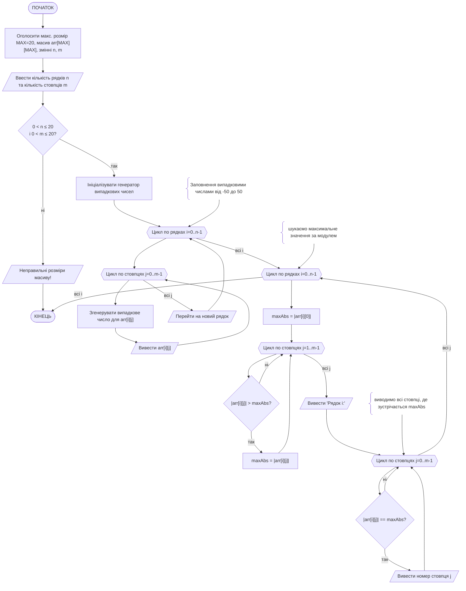
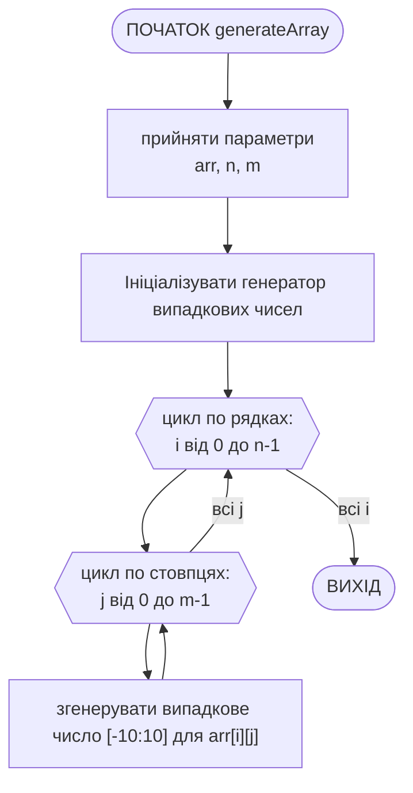
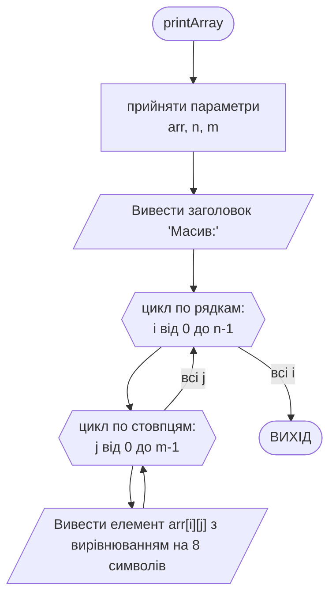
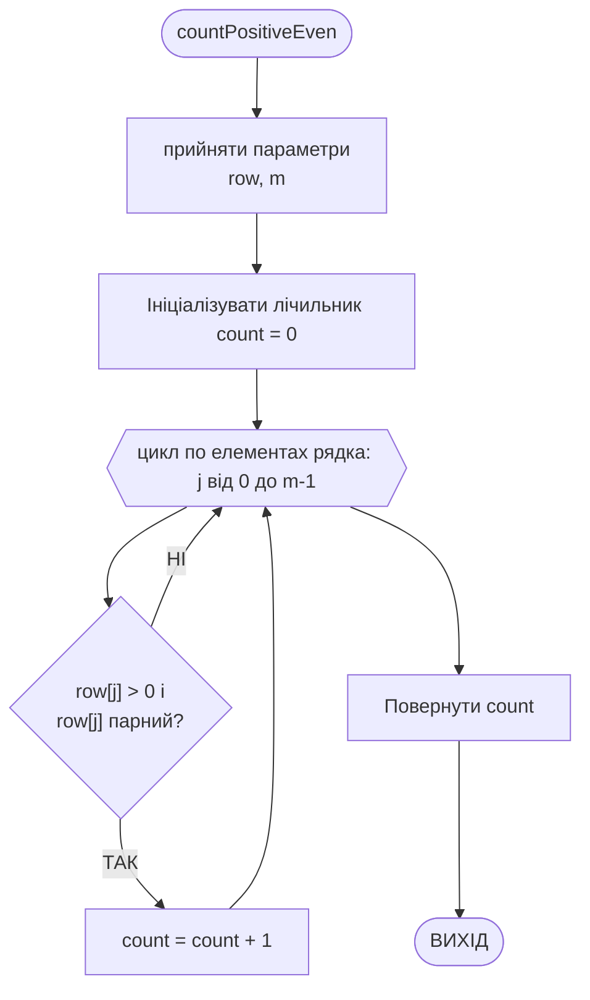
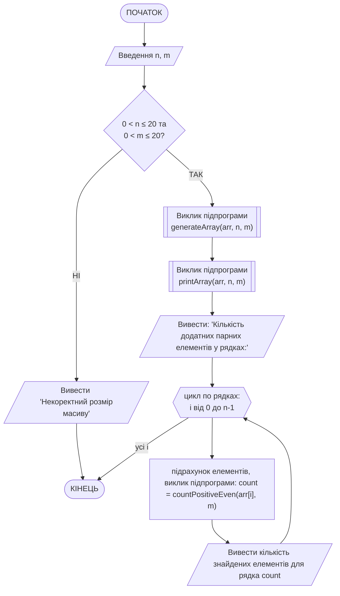

# Лабораторна робота №7. Двовимірні масиви

## Мета роботи

Ознайомлення з принципами роботи з двовимірними масивами (матрицями) у мові C++; отримання практичних навичок обробки елементів багатовимірних масивів з використанням вкладених циклів; закріплення навичок використання підпрограм для декомпозиції задач обробки масивів; закріплення навичок використання методів генерації псевдовипадкових чисел.

## Задачі роботи

1. Опанувати способи оголошення, ініціалізації та роботи з двовимірними масивами.

2. Навчитися використовувати генератор псевдовипадкових чисел (`rand()`, `srand()`) для автоматизованого заповнення масивів.

3. Організовувати обхід матриці (двовимірного масиву) за рядками та стовпцями з використанням вкладених циклів.

4. Навчитися виділяти логічні блоки обробки масивів (наприклад, генерація, виведення, обробка окремих рядків) в окремі підпрограми (функції).

5. Скласти блок-схему алгоритму і написати програму для обробки двовимірного масиву відповідно до індивідуального варіанта.

6. Оформити результати у вигляді звіту з наведенням схем алгоритмів, лістингів коду та результатів тестування.

## Перелік індивідуальних варіантів завдання

Загальна умова для всіх варіантів: ввести масив, який містить не більше 20х20 елементів дійсного типу.
Для кожного його рядка обчислити та вивести на екран:

### Таблиця 1 — Перелік індивідуальних варіантів

| № | Завдання для кожного рядка |
| --- | --- |
| 1 | Число нульових елементів. |
| 2 | Номери стовбців ненульових елементів. |
| 3 | Число негативних елементів. |
| 4 | Номери стовбців невід'ємних елементів. |
| 5 | Значення максимального елемента. |
| 6 | Номери стовбців мінімального елемента. |
| 7 | Число позитивних елементів. |
| 8 | Номери стовбців непозитивних елементів. |
| 9 | Значення максимального за модулем елемента. |
| 10 | Номери стовбців мінімального за модулем елемента. |
| 11 | Номери стовбців нульових елементів. |
| 12 | Число ненульових елементів. |
| 13 | Номери стовбців негативних елементів. |
| 14 | Число невід'ємних елементів. |
| 15 | Номери стовбців максимального елемента. |
| 16 | Значення мінімального елемента. |
| 17 | Номери стовбців позитивних елементів. |
| 18 | Значення мінімального позитивного елемента. |
| 19 | Число непозитивних елементів. |
| 20 | Значення максимального негативного елемента. |

## Теоретичні відомості

### 1. Двовимірні масиви у C++

Двовимірний масив можна уявити як матрицю або таблицю, що складається з рядків та стовпців. Доступ до елементів здійснюється за допомогою двох індексів: перший вказує на рядок, другий — на стовпець.

```cpp
const int MAX_ROWS = 20;
const int MAX_COLS = 20;
double arr[MAX_ROWS][MAX_COLS];
```

Для обходу таких масивів найзручніше використовувати вкладені цикли `for`. Зовнішній цикл зазвичай відповідає за перебір рядків, а внутрішній — за перебір елементів (стовпців) у поточному рядку.

### 2. Заповнення масиву випадковими числами

Для полегшення роботи з програмою масив чисел часто заповнюється за допомогою генератора псевдовипадкових чисел (ГПВЧ).
Щоб згенерувати дійсні числа у діапазоні [-50; 50] з дробовою частиною до двох знаків, використовується такий вираз:

```cpp
rand_var = (rand() % 101 - 50) + (rand() % 100) / 100.0;
```

Для ініціалізації ГПВЧ використовується функція `srand(time(0))` (необхідно підключити бібліотеки `<cstdlib>` та `<ctime>`).

## Приклад виконання завдання

### 1. Умова завдання

Написати програму на мові C++, яка виконує наступне завдання: ввести масив, який містить не більше 20х20 елементів дійсного типу (можна створити масив з використанням генератора випадкових чисел). Для кожного його рядка обчислити та вивести на екран номери стовбців максимального за модулем елемента.

### 2. Аналіз умови та теоретична підготовка розв'язку завдання

Для масиву встановлено максимальну розмірність 20х20, проте користувачу надається можливість вказувати довільний розмір в межах цієї розмірності. Для безпечного виконання програми введені користувачем значення розмірності перевіряються на відповідність вимогам.
Основна частина завдання виконується так:

1) організується цикл обходу по рядках масиву (перший вимір);
2) спочатку виконується обхід по усіх елементах рядка, для того, аби знайти та запам'ятати максимальний за модулем елемент (його значення);
3) виконується другий обхід по елементах поточного рядку, для того, аби вивести на екран індекси тих позицій, де знаходиться максимальний за модулем елемент (може бути не одна позиція).

### 3. Схема алгоритму програми (Mermaid)

Схема алгоритму основної програми `main()`, виконана за допомогою мови розмітки `mermaid`:



### 4. Програма на C++

Повний код програми, що реалізує завдання.

```cpp
#include <iostream>
#include <cstdlib>  // для rand(), srand()
#include <ctime>    // для time()
#include <cmath>    // для fabs()

using namespace std;

int main() {
    const int MAX = 20;
    int n, m;

    cout << "Введіть кількість рядків (не більше 20): ";
    cin >> n;
    cout << "Введіть кількість стовпців (не більше 20): ";
    cin >> m;

    if (n > MAX || m > MAX || n <= 0 || m <= 0) {
        cout << "Неправильні розміри масиву!" << endl;
        return 1;
    }

    double arr[MAX][MAX];

    // ініціалізація генератора випадкових чисел
    srand(time(0));

    cout << "\nМасив (" << n << "x" << m << "):\n";

    // Заповнення випадковими числами від -50 до 50
    for (int i = 0; i < n; i++) {
        for (int j = 0; j < m; j++) {
            // генерація значення елемента масиву
            arr[i][j] = (rand() % 101 - 50) + (rand() % 100) / 100.0; 
            // вивід елемента масиву
            cout << arr[i][j] << "\t"; 
        }
        cout << endl;
    }

    cout << "\nНомери стовпців максимальних за модулем елементів у рядках:\n";

    // Обробка рядків
    for (int i = 0; i < n; i++) {
        // шукаємо максимальне значення за модулем
        double maxAbs = fabs(arr[i][0]);
        for (int j = 1; j < m; j++) {
            if (fabs(arr[i][j]) > maxAbs) {
                maxAbs = fabs(arr[i][j]);
            }
        }

        // виводимо всі стовпці, де зустрічається maxAbs
        cout << "Рядок " << i << ": ";
        for (int j = 0; j < m; j++) {
            if (fabs(arr[i][j]) == maxAbs) {
                cout << j << " ";
            }
        }
        cout << endl;
    }

    return 0;
}
```

### 5. Пояснення принципів роботи програми

1. Використання додаткових розмірів масиву. Використовується статичний двовимірний масив `arr[20][20]`, але користувач має змогу ввести власні розміри `n` та `m`. Якщо введено некоректні розміри (≤0 або >20) – програма завершується.
2. Автоматизоване заповнення масиву. Масив заповнюється випадковими числами в діапазоні від -50.00 до +50.99 (саме так, не до 50.00, але для успішного виконання завдання це не принципово). Одразу після генерації елементи виводяться у вигляді матриці.
3. Обчислення максимальних за модулем елементів: Для кожного рядка знаходиться максимальне значення з використанням функції `fabs()`. Спочатку максимумом вважається перший елемент рядка, потім він порівнюється з іншими.
4. Визначення стовпців: Після знаходження найбільшого за модулем значення, програма повторно проходить по рядку і виводить усі індекси стовпців (з урахуванням дублікатів значень).

### 6. Приклад роботи програми в консолі

```cmd
Введіть кількість рядків (не більше 20): 4
Введіть кількість стовпців (не більше 20): 5

Матриця (4x5):
-6.4    -3.8     9.7     2.2     -9.7
 1.3     7.5    -7.5     0.4      2.1
-5.9     8.9    -2.3    -8.9      4.6
 0.5    -3.2     1.7    -6.8      6.8

Номери стовпців максимальних за модулем елементів у рядках:
Рядок 0: 2 4
Рядок 1: 1 2
Рядок 2: 1 3
Рядок 3: 3 4
```

### 7. Тестування програми

Для забезпечення надійності та всебічної перевірки алгоритму розроблено набір із таких тестових випадків:

| № тесту | Вхідні дані | Очікуваний результат | Мета перевірки |
| --- | --- | --- | --- |
| 1 | `n = 4` `m = 5` | Виведення згенерованої матриці 4х5. Виведення номерів стовпців з максимальними за модулем елементами для 4-х рядків. | Перевірка стандартного виконання програми на коректних типових даних. |
| 2 | `n = 1` `m = 1` | Виведення матриці 1х1. Для Рядка 0 виводиться номер стовпця `0`. | Перевірка роботи алгоритму на мінімально можливих допустимих значеннях розмірності (крайовий випадок). |
| 3 | `n = 20` `m = 20` | Виведення матриці 20х20. Розрахунок та виведення стовпців для 20-ти рядків. | Перевірка роботи програми на максимально допустимих межах масиву (крайовий випадок). |
| 4 | `n = 0` `m = 5` | Повідомлення: `Неправильні розміри масиву!` Програма завершує роботу. | Перевірка захисту від введення нульової розмірності (неочікувані дані). |
| 5 | `n = 5` `m = 25` | Повідомлення: `Неправильні розміри масиву!` Програма завершує роботу. | Перевірка спрацювання валідації при перевищенні верхньої допустимої межі (неочікувані дані). |
| 6 | `n = -3` `m = 4` | Повідомлення: `Неправильні розміри масиву!` Програма завершує роботу. | Перевірка обробки від'ємних значень розмірності масиву (неочікувані дані). |

## Приклад виконання завдання №2

### 1. Умова завдання №2

Написати програму на мові C++, яка виконує наступне завдання: ввести масив, який містить не більше 20х20 елементів цілого типу (можна створити масив з використанням генератора випадкових чисел). Для кожного його рядка обчислити та вивести на екран число позитивних парних елементів.

### 2. Аналіз умови та теоретична підготовка розв'язку завдання №2

Для полегшення роботи з програмою масив цілих чисел заповнюється автоматизованим способом: за допомогою генератора псевдовипадкових чисел (ГПВЧ). Параметри ГПВЧ можуть задаватись користувачем, або можуть бути зафіксовані у програмі, наприклад, дійсні числа у діапазоні [-10; 10]. Такі умови генерації можуть бути виконані за допомогою виразу:

```cpp
// генерація цілої частини на діапазоні [0; 20], 
// зі зміщенням на 10 в бік від'ємних чисел (відняти 10)
int rand_var = (rand() % 21 - 10);
```

Для масиву встановлено максимальну розмірність 20х20, проте користувачу надається можливість вказувати довільний розмір в межах цієї розмірності. Для роботи програми можна створити фіксований масив з максимальною розмірністю, у якому буде використовуватись частина, розмірність якої буде задаватись користувачем. Для безпечного виконання програми введені користувачем значення розмірності перевіряються на відповідність вимогам.

Окремі підзадачі у програмі виконуються за допомогою підпрограм:

1) генерація елементів масиву за допомогою генератора псевдовипадкових чисел; підпрограмі передаються масив та розміри (кількість стовпців та рядків), які ввів користувач; підпрограма наповнює переданий масив цілими числами; підпрограма нічого не повертає
2) підпрограма виведення масиву в консоль (на екран); підпрограмі передаються масив та розміри (кількість стовпців та рядків), які ввів користувач; програма взаємодіє з потоком вводу/виводу і нічого не повертає по завершенні роботи
3) підпрограма підрахунку позитивних парних елементів у рядку; підпрограмі передаються поточний рядок матриці (одновимірний масив) та кількість стовпців, яку ввів користувач; програма повертає ціле число - кількість знайдених позитивних парних елементів у рядку

Основна частина завдання виконується так:

1) створюється статичний масив 20x20
2) в користувача запитуються розміри матриці, з якою треба працювати (до 20 рядків та до 20 стовпців), кожне число перевіряється на умову (0 < x <= 20), інакше робота програми припиняється
3) за допомогою підпрограми масив наповнюється цілими випадковими числами в тій частині, розміри якої задав користувач
4) за допомогою підпрограми масив виводиться у консоль (на екран)
5) організується цикл обходу матриці по рядках, в якому для кожного рядка за допомогою підпрограми знаходиться кількість позитивних парних елементів, це значення одразу виводиться у консоль (на екран)

### 3. Схема алгоритму програми (Mermaid) для завдання №2

Схема алгоритму підпрограми `generateArray()`:



Схема алгоритму підпрограми `printArray()`:



Схема алгоритму підпрограми `countPositiveEven()`:



Схема алгоритму основної програми `main()`:



### 4. Програма на C++ для завдання №2

Ось програма на мові C++, яка виконує поставлене завдання. Вона генерує масив розміром до 20x20 (розміри задає користувач) з випадковими цілими числами (в діапазоні від -10 до 10), а потім для кожного рядка знаходить та виводить на екран число позитивних парних елементів.

```cpp
#include <iostream>
#include <cstdlib>  // rand, srand
#include <ctime>    // time
#include <iomanip>  // setw

using namespace std;

const int MAX_N = 20;
const int MAX_M = 20;

// Генерація масиву з випадковими цілими числами (у вигляді дійсних)
void generateArray(int arr[MAX_N][MAX_M], int n, int m) {
    srand(time(0));
    for (int i = 0; i < n; i++) {
        for (int j = 0; j < m; j++) {
            // Генеруємо випадкові цілі числа від -10 до 10  
            arr[i][j] = (rand() % 21 - 10);
        }
    }
}

// Виведення масиву в консоль (на екран)
void printArray(int arr[MAX_N][MAX_M], int n, int m) {
    cout << "Масив:" << endl;
    for (int i = 0; i < n; i++) {
        for (int j = 0; j < m; j++) {
            cout << setw(5) << arr[i][j];
        }
        cout << endl;
    }
}

// Підрахунок позитивних парних елементів у рядку
int countPositiveEven(int row[MAX_M], int m) {
    int count = 0;
    for (int j = 0; j < m; j++) {
        // Перевірка: число додатне і є парним цілим
        if (row[j] > 0 && row[j] % 2 == 0) {
            count++;
        }
    }
    return count;
}

int main() {
    int n, m;
    int arr[MAX_N][MAX_M];

    cout << "Введіть кількість рядків (не більше 20): ";
    cin >> n;
    cout << "Введіть кількість стовпців (не більше 20): ";
    cin >> m;

    if (n <= 0 || n > MAX_N || m <= 0 || m > MAX_M) {
        cout << "[x] Некоректний розмір масиву!" << endl;
        return 1;
    }

    // Генерація масиву
    generateArray(arr, n, m);

    // Виведення масиву
    printArray(arr, n, m);

    // Підрахунок для кожного рядка
    cout << endl;
    cout << "Кількість додатних парних елементів у рядках:" << endl;
    for (int i = 0; i < n; i++) {
        int count = countPositiveEven(arr[i], m);
        cout << "Рядок " << i + 1 << ": " << count << endl;
    }

    return 0;
}
```

### 5. Пояснення принципів роботи програми для завдання №2

1. Оголошення констант, які обмежують максимальний розмір статичного масиву. Програма може працювати з масивом розміром не більше 20×20.
2. Введення розмірів масиву
    - Користувач вводить кількість рядків n і стовпців m.
    - Якщо введено значення поза діапазоном (≤0 або >20), програма виведе повідомлення про помилку і завершить роботу.
3. Генерація елементів масиву
Функція generateArray() заповнює двовимірний масив випадковими цілими числами від -10 до 10, перетворюючи їх у тип double.
Використовується `srand(time(0))` для ініціалізації генератора випадкових чисел, та `rand() % 21 - 10` для генерації випадкового числа від -10 до 10
4. Виведення згенерованого масиву. Функція `printArray()` друкує матрицю у табличному вигляді.
5. Підрахунок позитивних парних елементів у кожному рядку. Для кожного рядка викликається функція `countPositiveEven()`, яка:
    - перевіряє кожен елемент;
    - якщо елемент додатний (`> 0`) і парний (`int(row[j]) % 2 == 0`), збільшує лічильник;
    - повертає кількість таких елементів.
6. Виведення результатів. Для кожного рядка виводиться кількість додатних парних чисел.
7. Завершення програми. Програма завершує виконання успішно (`return 0;`).

### 6. Приклад роботи програми в консолі для завдання №2

Приклад роботи програми для n=3 та m=5:

```bash
Введіть кількість рядків (не більше 20): 3
Введіть кількість стовпців (не більше 20): 5
Масив:
    5   -8   -5    6    7
  -10    7   -3   -9    3
   -8   -5    6    2    6

Кількість додатних парних елементів у рядках:
Рядок 1: 1
Рядок 2: 0
Рядок 3: 3
```

Приклад роботи програми для некоректних даних:

```bash
Введіть кількість рядків (не більше 20): 3
Введіть кількість стовпців (не більше 20): 24
[x] Некоректний розмір масиву!
```

### 7. Тестування програми для завдання №2

| № тесту | Вхідні дані | Очікуваний результат | Мета перевірки |
| --- | --- | --- | --- |
| 1 | `n = 3` `m = 5` | Виведення згенерованої матриці 3х5. Виведення кількості знайдених додатних парних чисел для 3-х рядків. | Перевірка коректності обчислень та виклику підпрограм на стандартних даних. |
| 2 | `n = 20` `m = 20` | Виведення матриці 20х20. Виведення підрахунку для 20-ти рядків. | Перевірка алгоритму та підпрограм на максимальному заповненні матриці (крайовий випадок). |
| 3 | `n = 1` `m = 10` | Виведення матриці 1х10. Підрахунок елементів тільки для 1-го рядка. | Перевірка обробки матриці-рядка (крайовий випадок — одновимірний вектор у вигляді двовимірного масиву). |
| 4 | `n = 21` `m = 10` | Повідомлення: `[x] Некоректний розмір масиву!` Програма завершує роботу без генерації. | Перевірка валідації на перевищення ліміту рядків `MAX_N` (неочікувані дані). |
| 5 | `n = 4` `m = -5` | Повідомлення: `[x] Некоректний розмір масиву!` Програма завершує роботу. | Перевірка обробки помилкового введення від'ємної кількості стовпців (неочікувані дані). |
| 6 | `n = 0` `m = 0` | Повідомлення: `[x] Некоректний розмір масиву!` Програма завершує роботу. | Перевірка реакції програми на відсутність вимірів масиву (неочікувані дані). |

## Вимоги до звіту

За результатами виконання індивідуального варіанта завдання треба підготувати звіт, складений за встановленим шаблоном.

**Структура звіту:**

1. Титульний аркуш із зазначенням назви дисципліни, номера лабораторної роботи та її теми, навчальної групи та ПІБ студента.
2. Текст завдання відповідно до призначеного індивідуального варіанта (з точним описом умов та обмежень).
3. Теоретичні відомості та опис способу вирішення завдання:
    - оголошення та принципи роботи з двовимірними масивами
    - способи наповнення масивів: генератори псевдовипадкових чисел
    - особливості вирішення завдання (пошук маскимальних, мінімальних значень, їх індексів, абсолютних значень)
4. Схеми алгоритму основної програми та створених підпрограм, оформлені відповідно до стандартів (блок-схема) у графічному вигляді, або згенеровані за допомогою мови опису діаграм Mermaid (код, що описує діаграму, теж треба додати у звіт).
5. Текст програми (лістинг коду). Обов'язкове оформлення моноширинним шрифтом (*Courier New*, *Consolas*, *Lucida Console* тощо). Наявність коментарів у ключових блоках коду.
6. Перелік тестових випадків та результати їх виконання:
    - тестування для коректних розмірів масиву;
    - тестування для некоректних даних (наприклад, перевищення ліміту розмірності або від'ємні розміри матриці);
    - копії вікна командного рядка (знімки екрана / скріншоти) з реальними результатами запуску програми для кожного тесту.
7. Висновки: підсумок щодо досягнення мети роботи, особливості функціонування розробленої програми, виявлені обмеження або потенційні шляхи покращення.
