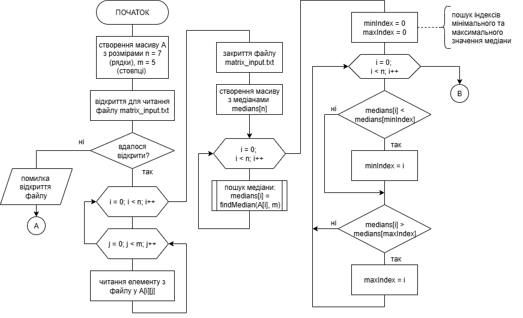
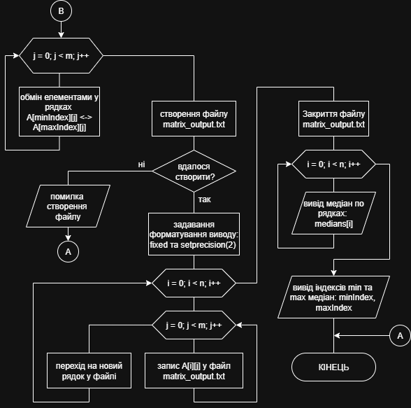
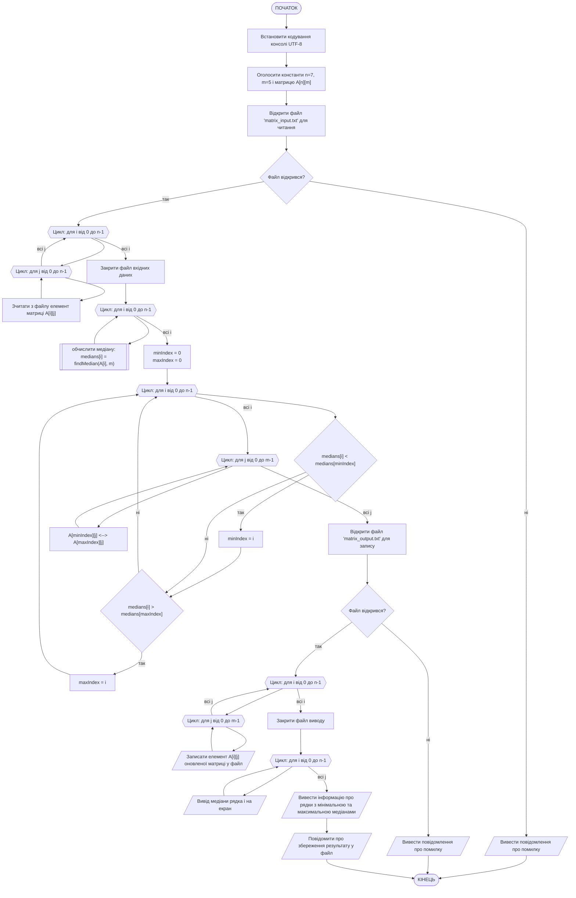
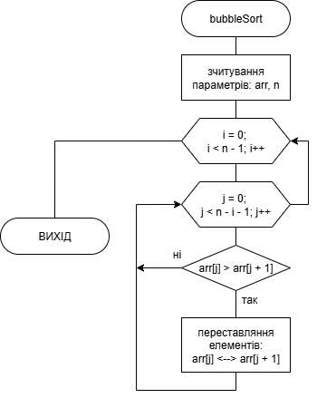
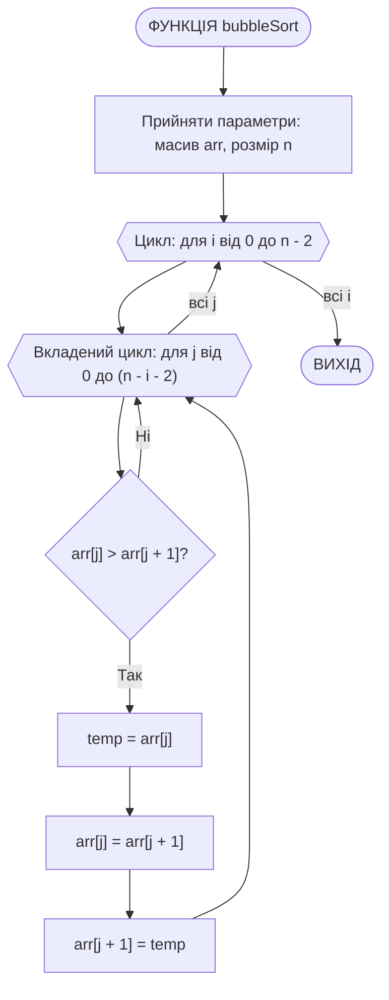
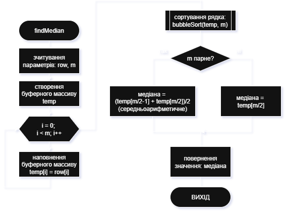
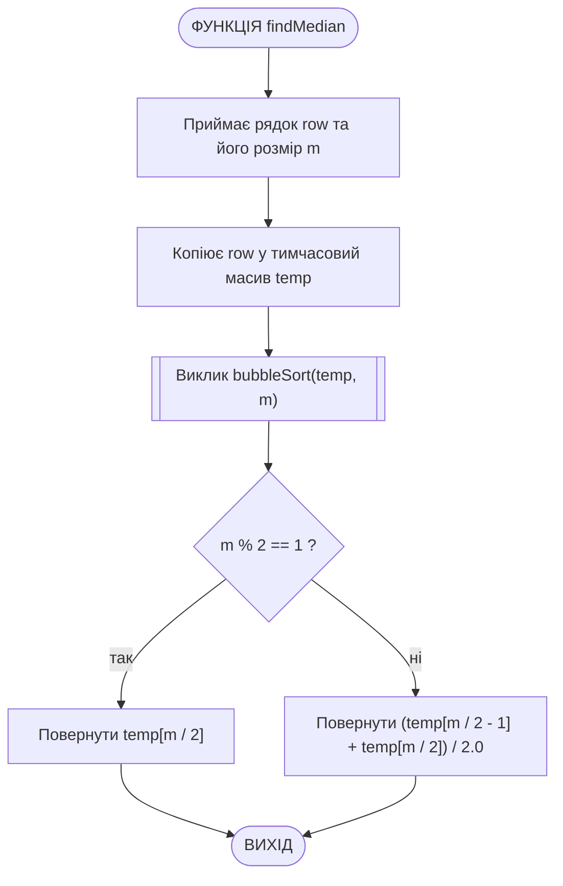
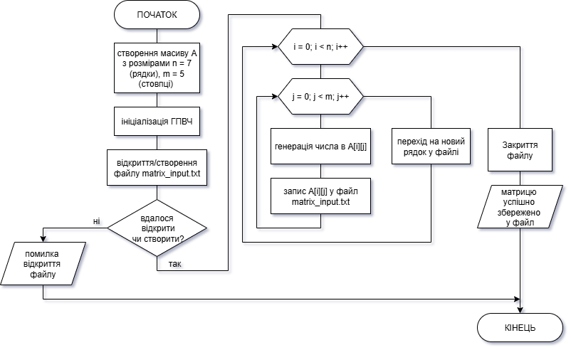
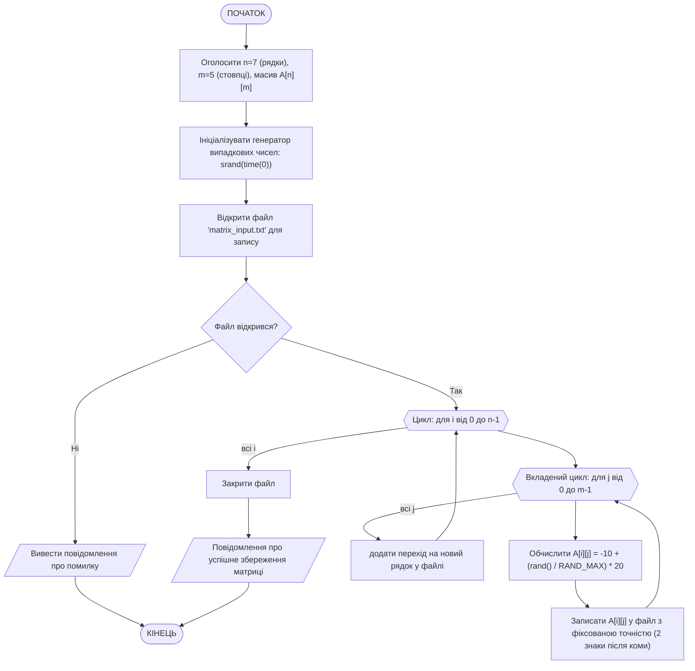

# Лабораторна робота №8. Аналіз та обробка двовимірного масиву

## Мета роботи

Ознайомлення з принципами роботи з текстовими файлами у мові C++ за допомогою бібліотеки `<fstream>`; отримання навичок зчитування з файлу та запису у файл даних та результатів роботи; закріплення практичного досвіду обробки даних у різних вимірах масивів, зокрема застосування алгоритмів обробки даних (сортування) і знаходження різних характеристик (середнє арифметичне, медіана, модуль, максимум та мінімум); розробка допоміжних програм для автоматизованої підготовки файлів з вхідними даними.

## Задачі роботи

1. Опанувати роботу з потоками вводу-виводу для роботи з файлами (`ifstream`, `ofstream`, `fstream`), обирати режими відкриття файлів та обробляти помилки доступу до файлової системи.
2. Зрозуміти принципи доступу до різних вимірів багатовимірних масивів для обробки числового ряду.
3. Розробити алгоритм, який комбінує файлові операції та обчислювальні процеси над матрицею.
4. (Додатково) Написати допоміжну програму для генерації тестових даних та збереження їх у файл.
5. Оформити результати у вигляді звіту з наведенням схем алгоритмів (Mermaid), лістингів коду та результатів тестування.

## Перелік індивідуальних варіантів завдання

Розробити програму на мові C++ для аналізу і обробки двовимірного масиву (матриці) відповідно до умови індивідуального варіанта завдання, поданого в табл. 1. Вхідну матрицю необхідно зчитувати з файла. Розмірність матриці та тип її елементів (цілі або дійсні числа) визначаються індивідуальним завданням. Для виконання логічно завершених дій (читання з файлу, запис у файл, обчислення специфічних параметрів, сортування тощо) можна використовувати власні підпрограми. Результати роботи програми представити на екрані та записати в окремий текстовий файл. Скласти блок-схему та підготувати звіт про виконання роботи.

(Додатково) Розробити допоміжну програму, яка автоматично створює вхідний текстовий файл і наповнює його тестовими даними відповідного типу (константним значенням, псевдовипадковими числами, помилковими даними) у вигляді матриці заданої розмірності.

### Таблиця 1 — Перелік індивідуальних варіантів

| № вар. | Індивідуальне завдання |
| :---: | --- |
| 1 | За введеною матрицею дійсних чисел розміром $5\times7$ обчислити нову матрицю, в якій кожен елемент обчислюється як півсума середньоарифметичних відповідних рядка і стовпця |
| 2 | У матриці дійсних чисел розміром $5\times5$ обчислити визначник |
| 3 | У матриці дійсних чисел розміром $5\times4$ обчислити суму елементів у тих стовпцях, які не містять негативних елементів |
| 4 | Обчислити добуток матриці $5\times5$ цілих чисел на її транспоновану матрицю |
| 5 | У матриці дійсних чисел розміром $7\times3$ обчислити добуток елементів у тих рядках, які не містять негативних елементів |
| 6 | Створити вектор з рядка матриці дійсних чисел розміром $8\times3$, найменш віддаленого від другого рядка (відстань між рядками обчислюється за формулою $d_{i}=\sum_{j=0}^{2}\|a_{ij}+a_{2j}\|$) |
| 7 | Ввести матрицю $5\times5$ цілих чисел від 0 до 9. Якщо кількість повторів елемента матриці збігається з самим елементом, то замінити його на нуль |
| 8 | Упорядкувати за зростанням (зліва направо) елементи всіх рядків матриці дійсних чисел розміром $4\times4$, а тоді за зростанням (зверху вниз) - елементи всіх стовпців |
| 9 | Сформувати вектор як рядок матриці дійсних чисел розміром $5\times5$, найбільш віддалений від першого рядка (відстань від першого рядка матриці до і-го обчислюється за формулою $d_{i}=\sum_{j=0}^{4}\|a_{jj}\|+\|a_{1j}\|, i\ne1$) |
| 10 | Сформувати вектор як стовпець матриці дійсних чисел розміром $6\times8$, найменш віддалений від першого (відстань між ј-м стовпцем і першим обчислюється за формулою $d_{j}=\sum_{t=0}^{5}\|a_{tj}\|\cdot\|a_{t1}\|, j\ne1$) |
| 11 | Кожен від'ємний елемент матриці дійсних чисел розміром $4\times8$ замінити сумою додатних елементів того рядка, в якому розміщений цей елемент |
| 12 | У матриці цілих чисел розміром $6\times6$ визначити мінімальний елемент у секторі над головної діагоналлю і мінімальний елемент у секторі під головною діагоналлю. Найбільше з цих значень замінити елементи головної діагоналі |
| 13 | Ввести матрицю розміром $3\times5$ з цілих чисел від 0 до 9. Обчислити відсотковий вміст кожного з цих чисел у матриці |
| 14 | У матриці цілих чисел розміром $6\times7$ визначити рядок з мінімальною сумою і поміняти місцями цей рядок з першим |
| 15 | Створити вектор з рядка матриці дійсних чисел розміром $7\times5$, найбільш віддаленого від третього рядка (відстань між рядками обчислюється за формулою $d_{i}=\sum_{j=0}^{4}\|a_{ij}+a_{3j}\|$) |
| 16 | Ввести матрицю розміром $6\times4$ з цілих чисел від 0 до 9. Обчислити вектор з 10-ти елементів як значення кількості повторів цих констант у матриці |
| 17 | Якщо в матриці дійсних чисел $4\times5$ сума додатних чисел більше модуля суми від'ємних, то замінити кутові елементи середнім арифметичним елементів матриці. Інакше видати про це повідомлення |
| 18 | Ввести дві матриці дійсних чисел $4\times5$. Поміняти місцями рядки матриць, які містять максимальні елементи |
| 19 | Ввести матрицю дійсних чисел $5\times5$ і вектор з п'яти дійсних чисел. Замінити всі рядки матриці, в яких є від'ємні числа, на елементи вектора |
| 20 | За матрицею цілих чисел розміром $4\times5$ обчислити вектор як середні арифметичні значення елементів тих стовпців, які містять максимальний і мінімальний елементи |
| 21 | Якщо в матриці цілих чисел $5\times6$ міститься парна кількість від'ємних елементів, то замінити будь-яку половину з цих чисел на нуль, інакше замінити всі від'ємні елементи на значення їхньої кількості |
| 22 | Вивести елемент матриці $6\times6$ з найбільшою відстанню до діагоналі (відстань обчислюється за формулою $d_{ij}=\sum_{i=0}^{5}\|\sum_{j=0}^{5}\|a_{ij}-a_{jj}\|-a_{ii}\|$) |
| 25 | Обчислити вектор як найбільш віддалений стовпець від $(n-1)$ -го стовпця матриці дійсних чисел розміром $6\times5$ (відстань обчислюється за формулою $d_{j}=\sum_{i=0}^{4}\|a_{ij}\|+\|a_{i,n-1}\|$). Значення n ввести з екрана |

## Теоретичні відомості

### 1. Робота з файлами у програмах на C++

За загальними умовами завдання початкові дані мають завантажуватись з текстового файлу, а результати - зберігатись у текстовий файл. Для роботи з текстовими файлами у мові С++ використовується стандартна бібліотека `<fstream>`. У заголовковому файлі `<fstream>` оголошено три основні класи:

- `ifstream` - ввід із файлу (читання)
- `ofstream` - вивід у файл (запис)
- `fstream` - ввід і вивід одночасно

Відкриття файлу здійснюється одним з двох способів:

1. За допомогою конструктора:

    ```cpp
    ifstream fin("data.txt");   // відкриття для читання
    ofstream fout("output.txt"); // відкриття для запису
    ```

2. За допомогою метода `open()`:

    ```cpp
    ifstream fin;
    fin.open("data.txt");
    ```

При відкритті файлів можна використовувати додаткові прапори для визначення режиму роботи з ним:

| Прапор        | Опис                                                 |
| ------------- | ---------------------------------------------------- |
| `ios::in`     | відкриття для читання                                |
| `ios::out`    | відкриття для запису  (старий вміст буде видалено)   |
| `ios::app`    | додавання в кінець файлу                             |
| `ios::trunc`  | очищення файлу при відкритті                         |
| `ios::binary` | двійковий режим                                      |
| `ios::ate`    | встановлення вказівника в кінець файлу при відкритті |

При використанні `ifstream` та `ofstream` ящо не вказувати режим явно, він обирається автоматично (відповідно `ios::in` та `ios::out`). Іноді виникає потреба відкрити файл для дозапису даних, без видалення вже існуючих у файлі. Тоді слід вказувати режим явно, наприклад:

```cpp
ofstream fout("log.txt", ios::app);
```

Перевірка відкриття файлу здійснюється через його вказівник:

```cpp
ifstream fin("data.txt");
if (!fin) {
    cout << "Не вдалося відкрити файл!" << endl;
}
```

або за допомогою методу `is_open()`:

```cpp
ifstream fin("data.txt");
if (!fin.is_open()) {
    cout << "Помилка відкриття файлу!" << endl;
}
```

Після використання файл слід закривати:

```cpp
fin.close();
```

Після відкриття запис у файл здійснюється так само, як і вивід у консоль, тільки використовується вказівник файла:

```cpp
fout << "Hello, file!" << endl;
fout << 123 << " " << 45.6 << endl;
```

Читання даних з файлу може здійснюватись одним зі способів:

1. Построчно, за допомогою функції `getline()`: `string line; getline(fin, line);`
2. Послівно, за принципом, схожим на зчитування даних з `cin`: `fin >> word`, оператор `>>` автоматично читає наступну послідовність символів, пропускаючи будь-яку кількість пробілів, символів табуляції чи переходів рядка.
3. По символах: `char ch; fin.get(ch);`

## Приклад виконання завдання

### 1. Умова завдання

Зробити програму на С++, яка виконує наступне завдання:
Завантажити матрицю дійсних чисел розміром 7х5 з текстового файлу, обчислити медіану по кожному рядку, поміняти місцями рядки, у яких медіана має найбільше та найменше значення. Після цього оновлену матрицю зберегти у новий файл.

Додатково написати програму, яка створює файл з початковою матрицею, наповнюючи її дійсними числами в діапазоні (-10, 10) за допомогою генератора випадкових чисел.

### 2. Аналіз умови та теоретична підготовка розв'язку завдання

Медіана - значення, яке розташоване по середині відсортованої послідовності чисел. Для обчислення медіани необхідно:

1) відсортувати послідовність чисел у рядку матриці, для цього необхідно використати якийсь з алгоритмів сортування.
2) знайти медіану: реалізувати універсальний алгоритм (в залежності від парної або непарної кількості елементів у рядку), для парної кількості елементів, медіана обчислюється за формулою:

    $$Медіана = \frac{X_{n/2} + X_{(n/2)+1}}{2}$$

3) для непарної кількості елементів медіана - це центральний елемент відсортованої послідовності:

    $$Медіана = X_{(n+1)/2}$$

### 3. Програма, що виконує завдання

Повний код програми на C++, яка реалізує поставлене завдання (lab_08_ex1.cpp):

```cpp
#include <iostream>
#include <fstream>
#include <iomanip>
#include <cstdlib>
#include <ctime>
#include <cmath> // для fabs()
#include <windows.h> // для SetConsoleOutputCP

using namespace std;

// Функція сортування одного рядка методом бульбашки
void bubbleSort(double arr[], int n) {
    for (int i = 0; i < n - 1; i++) {
        for (int j = 0; j < n - i - 1; j++) {
            if (arr[j] > arr[j + 1]) {
                double temp = arr[j];
                arr[j] = arr[j + 1];
                arr[j + 1] = temp;
            }
        }
    }
}

// Функція для знаходження медіани одного рядка
double findMedian(double row[], int m) {
    double temp[5];
    for (int i = 0; i < m; i++) temp[i] = row[i];

    bubbleSort(temp, m); // сортуємо копію рядка

    if (m % 2 == 1)
        return temp[m / 2];
    else
        return (temp[m / 2 - 1] + temp[m / 2]) / 2.0;
}

int main() {
    // Перемикаємо консоль у UTF-8
    SetConsoleOutputCP(CP_UTF8);

    const int n = 7;
    const int m = 5;
    double A[n][m];

    // === 1. Зчитування матриці з файлу ===
    ifstream fin("matrix_input.txt");
    if (!fin) {
        cerr << "Помилка відкриття файлу для читання!" << endl;
        return 1;
    }

    for (int i = 0; i < n; i++) {
        for (int j = 0; j < m; j++) {
            fin >> A[i][j];
        }
    }
    fin.close();

    // === 2. Обчислення медіани для кожного рядка ===
    double medians[n];
    for (int i = 0; i < n; i++) {
        medians[i] = findMedian(A[i], m);
    }

    // === 3. Пошук рядків з мінімальною і максимальною медіанами ===
    int minIndex = 0, maxIndex = 0;
    for (int i = 1; i < n; i++) {
        if (medians[i] < medians[minIndex]) minIndex = i;
        if (medians[i] > medians[maxIndex]) maxIndex = i;
    }

    // === 4. Обмін рядків місцями ===
    for (int j = 0; j < m; j++) {
        double temp = A[minIndex][j];
        A[minIndex][j] = A[maxIndex][j];
        A[maxIndex][j] = temp;
    }

    // === 5. Запис оновленої матриці у новий файл ===
    ofstream fout("matrix_output.txt");
    if (!fout) {
        cerr << "Помилка відкриття файлу для запису!" << endl;
        return 1;
    }

    fout << fixed << setprecision(2);
    for (int i = 0; i < n; i++) {
        for (int j = 0; j < m; j++) {
            fout << setw(8) << A[i][j] << " ";
        }
        fout << endl;
    }
    fout.close();

    // === 6. Вивід результатів на екран ===
    cout << "Медіани по рядках:" << endl;
    for (int i = 0; i < n; i++) {
        cout << "Рядок " << i + 1 << ": " << medians[i] << endl;
    }

    cout << "\nМінімальна медіана у рядку " << minIndex + 1
         << ", максимальна — у рядку " << maxIndex + 1 << endl;

    cout << "Оновлену матрицю збережено у файл 'matrix_output.txt'" << endl;

    return 0;
}
```

### 4. Пояснення принципів роботи програми

1. **Функція bubbleSort(double arr[], int n)**: бере масив `arr` довжиною `n` та здійснює сортування по зростанню значень його елементів (порядок сортування на справді є непринциповим, можна сортувати і по спаданню).
2. **Функція findMedian(double row[], int m)**: бере поточний рядок матриці row з кількістю елементів m, виконує сортування, та, в залежності від парності адо непарності кількості елементів здійснює розрахунок медіани.
3. **Основна програма main()**:
   - зчитує дані з файла, виводить матрицю на екран
   - здійснює пошук медіан по кожному рядку матриці та запис у вектор медіан
   - здійснює пошук рядків (індексів) з min та max значеннями медіан
   - виконує обмін рядків
   - зберігає змінену матрицю у файл
   - виводить змінену матрицю на екран

### 5. Приклад результатів роботи програми

Перед виконанняя програми необхідно створити файл **matrix_input.txt** з наступним вмістом:

```bash
    4.51     8.84    -7.98     7.43    -4.06 
    7.38     8.55     9.37    -8.46     8.47 
    5.45     6.83     8.77     5.57    -5.29 
   -3.34     8.70    -9.13     3.55    -4.21 
   -5.32     1.77     7.48     4.59    -5.05 
   -4.48    -1.13     3.63     4.82     5.14 
   -8.34     2.02    -5.90    -0.21    -7.17 
```

Після виконання програма виводить в консоль:

```bash
Медіани по рядках:
Рядок 1: 4.51
Рядок 2: 8.47
Рядок 3: 5.57
Рядок 4: -3.34
Рядок 5: 1.77
Рядок 6: 3.63
Рядок 7: -5.9

Мінімальна медіана у рядку 7, максимальна — у рядку 2
Оновлену матрицю збережено у файл 'matrix_output.txt'
```

Результат обробки матриці програма зберігає у файл **matrix_output.txt**:

```bash
    4.51     8.84    -7.98     7.43    -4.06 
   -8.34     2.02    -5.90    -0.21    -7.17 
    5.45     6.83     8.77     5.57    -5.29 
   -3.34     8.70    -9.13     3.55    -4.21 
   -5.32     1.77     7.48     4.59    -5.05 
   -4.48    -1.13     3.63     4.82     5.14 
    7.38     8.55     9.37    -8.46     8.47 
```

### 6. Схема алгоритму програми

Алгоритм роботи основної програми можна описати наступним чином:

1. Зчитування початкових даних.
    - Відкрити файл з початковими даними.
    - Якщо не вдалося відкрити файл - вивести повідомлення про помилку та завершити програму
    - Зчитати матрицю з файлу у заздалегідь підготовлений масив у пам'яті.
    - Закрити файл з початковими даними.
2. Вивести початкову матрицю на екран.
3. Пошук медіан по кожному рядку матриці та запис у вектор медіан.
    - відсортувати елементи у рядку
    - взяти середній елемент, якщо кількість елементів непарна
    - взяти середне арифметричне двох середніх елементів, якщо кількість елементів парна
4. Пошук рядків з мінімальним та максимальним значеннями медіани.
5. Обмін рядків у матриці.
6. Збереження зміненої матриці у файл.
    - Відкрити або створити файл для виведення
    - Якщо не вдалося відкрити або створити файл - вивести повідомлення про помилку та завершити програму
    - Записати змінену матрицю у файл
    - Закрити файл
7. Вивести змінену матрицю на екран.

Схеми алгоритмів для основної програми та підпрограм, що виконують завдання, описано за допомогою можливостей онлайн-редактора draw.io (app.diagrams.net). Нижче подано результати експорту схем алгоритмів з різними варіантами налаштувань.

#### Схема алгоритму основної програми `main()`


(тема: світла, фоновий колір: білий, без тіні від ліній та блоків)


(тема: темна, фоновий колір: чорний, без тіні від ліній та блоків)

Схема алгоритму основної програми за допомогою мови розмітки `mermaid`:



#### Схема алгоритму підпрограми `bubbleSort()`


(тема: світла, без заповнення фону кольором (прозорий), без тіні від ліній та блоків)

Схема алгоритму підпрограми `bubbleSort()` за допомогою мови розмітки `mermaid`:



#### Схема алгоритму підпрограми `findMedian()`


(тема: темна, без заповнення фону кольором (прозорий), тінь від ліній та блоків)

Схема алгоритму підпрограми `findMedian()` за допомогою мови розмітки `mermaid`:



### 7. Додаткове завдання

Для полегшення роботи з даними була додатково створена програма, яка наповнює файл з початковою матрицею заданого розміру. Програма створює текстовий файл і наповнює його дійсними числами в діапазоні (-10, 10) за допомогою генератора випадкових чисел у вигляді матриці з заданими користувачем розмірами.

#### Текст програми додаткового завдання

Ось програма на C++, яка виконує додаткове завдання (`lab_08_data_generator.cpp`):

```cpp
#include <iostream>
#include <fstream>
#include <iomanip> // setw(), setprecision()
#include <cstdlib>
#include <ctime>
#include <windows.h> // для SetConsoleOutputCP

using namespace std;

int main() {
    // Перемикаємо консоль у UTF-8
    SetConsoleOutputCP(CP_UTF8);

    const int n = 7;  // кількість рядків
    const int m = 5;  // кількість стовпців
    double A[n][m];

    srand(time(0)); // ініціалізація генератора випадкових чисел

    ofstream fout("matrix_input.txt");
    if (!fout) {
        cerr << "Помилка відкриття файлу для запису!" << endl;
        return 1;
    }

    // Генеруємо матрицю з випадкових дійсних чисел у діапазоні (-10; 10)
    for (int i = 0; i < n; i++) {
        for (int j = 0; j < m; j++) {
            A[i][j] = -10 + (rand() / (double)RAND_MAX) * 20; // випадкове число (-10; 10)
            fout << setw(8) << fixed << setprecision(2) << A[i][j] << " ";
        }
        fout << endl;
    }

    fout.close();
    cout << "Матрицю успішно збережено у файл 'matrix_input.txt'" << endl;

    return 0;
}
```

#### Пояснення принципів роботи програми (`lab_08_data_generator.cpp`)

1. Створення матриці необхідного розміру (розміри задаються константами).
2. Ініціалізація ГПВЧ за допомогою мітки поточного часу `srand(time(0));`.
3. Відкриття/створення текстового файлу на запис. Перевілка успішності операції.
4. Цикл генерації елементів матриці - дійсних чисел на діапазоні (-10; 10). Сгенеровані числа записуються у відповідну кількість стовпці та рядків з відступом setw(8) та точністю setprecision(2).
5. Закриття файлу

#### Схема алгоритму програми (`lab_08_data_generator.cpp`)

Схема алгоритму додаткової програми (файл `lab_08_data_generator.cpp`):



Схема алгоритму додаткової програми `lab_08_data_generator.cpp` за допомогою мови розмітки `mermaid`:



### 8. Тестування роботи програми завдання

Виконати перевірку роботи програми на різних варіантах вхідних даних (згенерувати за допомогою програми додаткового завдання або підготувати вручну). Результати тестування додати у звіт у вигляді наступної таблиці:

| № тесту | Стан середовища / Вхідні дані | Очікуваний результат | Мета перевірки |
| --- | --- | --- | --- |
| 1 | Файл `matrix_input.txt` існує і містить коректну матрицю 7х5 з дійсними числами. | Програма успішно читає дані, обчислює медіани, знаходить мінімум/максимум, обмінює рядки та створює файл `matrix_output.txt`. | Перевірка стандартного виконання алгоритму (happy path). |
| 2 | Файл `matrix_input.txt` не існує або перейменований. | Вивід у консоль: `Помилка відкриття файлу для читання!` та завершення роботи. | Перевірка обробки відсутності вхідного файлу. |
| 3 | Файл `matrix_input.txt` містить меншу кількість елементів, ніж 7х5. | Можлива некоректна поведінка або зчитування сміття з пам'яті (залежить від ініціалізації). *Рекомендовано передбачити перевірку кінця файлу `!fin.eof()`*. | Перевірка поведінки програми на неповному файлі даних (неочікувані дані). |
| 4 | Матриця має кілька рядків з однаковою максимальною або мінімальною медіаною. | Буде здійснено обмін із першим знайденим максимумом/мінімумом через жорстку умову `<` та `>`. | Перевірка логіки пошуку екстремумів при наявності дублікатів (крайовий випадок). |
| 5 | Файл створено з атрибутом "Тільки для читання" (`matrix_output.txt`). | Вивід у консоль: `Помилка відкриття файлу для запису!` | Перевірка захисту від помилок доступу файлової системи. |

## Вимоги до звіту

За результатами виконання індивідуального варіанта завдання треба підготувати звіт, складений за встановленим шаблоном.

**Структура звіту:**

1. Титульний аркуш із зазначенням назви дисципліни, номера лабораторної роботи та її теми, навчальної групи та ПІБ студента.
2. Текст завдання відповідно до призначеного індивідуального варіанта (з точним описом умов та обмежень).
3. Теоретичні відомості та опис способу вирішення завдання:
    - короткий опис функцій файлового вводу-виводу
    - особливості вирішення завдання: способи знажодження необхідних характеристик, додатково оголошені структури даних, формули та вирази
    - використані способи створення початкових даних (алгоритм наповнення масиву, генератори псевдовипадкових чисел)
4. Схеми алгоритму основної програми та створених підпрограм, оформлені відповідно до стандартів (блок-схема) у графічному вигляді, або згенеровані за допомогою мови опису діаграм Mermaid (код, що описує діаграму, теж треба додати у звіт).
5. Текст програми (лістинг коду). Обов'язкове оформлення моноширинним шрифтом (*Courier New*, *Consolas*, *Lucida Console* тощо). Наявність коментарів у ключових блоках коду.
6. Перелік тестових випадків та результати їх виконання:
    - тестування для різних варіантів вхідних даних масиву;
    - тестування нештатних випадків (наприклад, перевищення ліміту розмірності, некоректні дані, помилки, пов'язані з доступністю файлів);
    - копії вікна командного рядка (знімки екрана / скріншоти) з вмістом файлу вхідних даних, реальними результатами запуску програми для кожного тесту, вмістом файлу результатів роботи програми.
7. При виконанні додаткового завдання: опис реалізованих можливостей з наповнення файлу початкових даних, схема алгоритму роботи програми, текст коду програми, приклад результатів її роботи.
8. Висновки: підсумок щодо досягнення мети роботи, особливості функціонування розробленої програми, виявлені обмеження або потенційні шляхи покращення.
