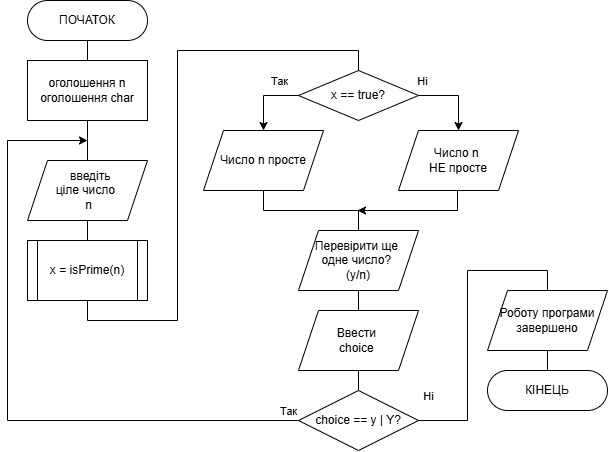
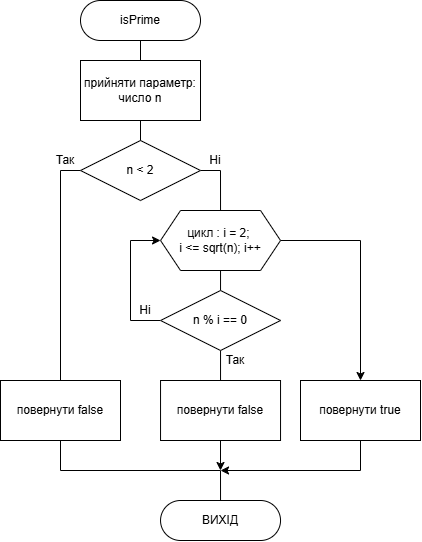
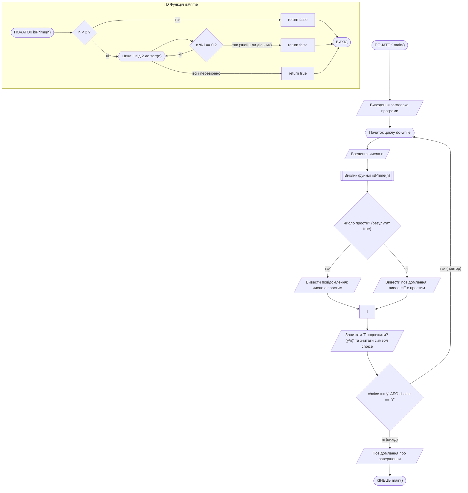

# Лабораторна робота №9. Функції та організація інтерактивних циклічних процесів

## Мета роботи

Ознайомлення з принципами оголошення та використання функцій у мові C++; отримання навичок розбиття програми на логічні підпрограми; закріплення практичного досвіду організації циклічних обчислювальних процесів із перевіркою умов виходу (нескінченних циклів); розробка інтерактивних консольних застосунків.

## Задачі роботи

1. Опанувати синтаксис оголошення, визначення та виклику функцій у C++.
2. Зрозуміти принципи організації безперервного введення та обробки даних у циклі (наприклад, за допомогою `while` або `do-while`).
3. Розробити алгоритм, який комбінує виклики функцій з обчисленнями та інтерактивну взаємодію з користувачем до отримання команди на завершення роботи.

## Перелік індивідуальних варіантів завдання

Скласти алгоритм та написати програму для розв'язання завдання, поданого в таблиці 1 відповідно до індивідуального варіанта. Розв'язання завдань організувати за допомогою створення користувацьких функцій.

**Увага!** Основна програма повинна працювати у нескінченному циклі. Замість виконання обчислення лише один раз (або для вказаної в завданні "заданої кількості"), програма має запитувати вхідні дані, викликати функцію для обчислення, виводити результати на екран, а потім запитувати користувача, чи бажає він продовжити. Цикл повинен повторюватися, доки користувач не введе команду зупинки (наприклад, символ `n` або `0`).

### Таблиця 1 — Перелік індивідуальних варіантів

| № вар. | Завдання |
| :---: | --- |
| 1 | Створити функцію обчислення середнього геометричного трьох чисел за формулою $\sqrt[3]{x\cdot y\cdot z}$ та за допомогою цієї функції визначити значення середнього геометричного введених користувачем чисел |
| 2 | Створити функцію визначення найменшого з двох чисел й обчислити для введених чисел $a$ та $b$ значення $z=min(a,2b)+min(2a-b,b)$ |
| 3 | Створити функцію обчислення $z=\frac{x+\sin y}{\sin x+y}$ та визначити значення виразу накопичувальної суми $S=z_i+z_{i-1}$ для кожної спроби введення значень для змінних $x$ та $y$ |
| 4 | Створити функцію обчислення факторіалу та за її допомогою визначити число різних сполучень із $n$ елементів по $m$ ($n>m$) за формулою $C_{n}^{m}=\frac{n!}{m!(n-m)!}$ |
| 5 | Для трикутника з довжинами сторін $a$, $b$ і $c$ значення медіани для сторони $a$ обчислюється за формулою $0.5\sqrt{2b^{2}+2c^{2}-a^{2}}$. Створити функцію для обчислення медіани та за її допомогою визначити медіани для всіх сторін трикутника |
| 6 | Створити функцію обчислення $z=\frac{\sqrt{x}+x}{y+\sqrt{y}}$ та визначити значення виразу накопичувальної суми $S=z_i+z_{i-1}$ для кожної спроби введення значень для змінних $x$ та $y$ |
| 7 | Створити функцію для обчислення $sh(x)=(e^{x}-e^{-x})/2$ та за її допомогою визначити $sh(x)tg(x+1)-ctg^{2}(2+sh(x-1))$ для введеного значення $x$ |
| 8 | Створити функцію визначення найбільшого з двох чисел й обчислити для двох введених чисел $a$ та $b$ значення $y=max(2a-b,2b-a)+max(a,b)$ |
| 9 | Створити функцію обчислення суми цифр числа та визначити за її допомогою суми цифр для введеного користувачем числа |
| 10 | Створити функцію визначення абсолютного значення (за модулем) числа (без використання стандартних математичних функцій) та обчислити за її допомогою модуль введеного значення |
| 11 | Створити функцію обчислення степеню натурального числа з натуральним показником (без використання функції pow) та обчислити за її допомогою значення $a^{x}$ та $x^{a}$ для введених натуральних чисел $a$ та $x$ |
| 12 | Створити функцію обчислення кількості цифр числа та визначити за її допомогою кількість цифр для введеного числа |
| 13 | Створити функцію обчислення третього степеню значення дійсного числа (без використання функції pow) та визначити куб введеного числа |
| 14 | Створити функцію обміну значеннями двох дійсних змінних та за її допомогою поміняти місцями введені $x$ та $y$ |
| 15 | Створити функцію визначення кількості цифр числа та за її допомогою обчислити розмірність введеного числа |
| 16 | Створити функцію обчислення факторіалу та визначити вираз $z=\frac{a\cdot b! - c\cdot d!}{e!+f!}$ для введених користувачем параметрів |
| 17 | Створити функцію обчислення перестановок $n!$ та визначити, якою кількістю способів можна розсадити $n$ студентів у ряд |
| 18 | Скількома можливими способами можна вибрати з $n$ людей делегацію у складі $k$ осіб, якщо число всіх сполучень із $n$ елементів по $k$ ($1\le k\le n$) обчислюється за формулою $C_{n}^{k}=\frac{n!}{k!(n-k)!}$ |
| 19 | Створити функцію обчислення середнього геометричного чотирьох чисел за формулою $\sqrt[4]{a\cdot b\cdot c\cdot d}$ та за допомогою цієї функції визначити середнє геометричне |
| 20 | Створити функцію обчислення $z=\frac{\sqrt{x}+x}{2}$ та визначати значення виразу накопичувальної суми $S=z_i+z_{i-1}$ для кожної спроби введення значення для змінної $x$ |
| 21 | Створити функцію обчислення найбільшого спільного дільника (НСД) двох натуральних чисел за алгоритмом Евкліда та за допомогою неї визначити НСД для введених чисел |
| 22 | Створити функцію обчислення гіпотенузи прямокутного трикутника за значеннями двох катетів та за допомогою цієї функції визначити для введених значень катетів значення гіпотенузи |
| 23 | Створити функцію обчислення відстані між двома точками площини за їх координатами $(x_1, y_1)$ та $(x_2, y_2)$ і за її допомогою визначити відстань між введеними точками |
| 24 | Створити функцію обчислення площі круга за його радіусом $S = \pi r^2$ та за її допомогою визначити площу круга із заданим радіусом |
| 25 | Створити функцію обчислення гіперболічного косинуса за формулою $ch(x) = (e^x + e^{-x})/2$ та за її допомогою обчислити значення виразу $ch(a) + ch(b) - ch(a+b)$ для введених $a$ та $b$ |
| 26 | Створити функцію обчислення найменшого спільного кратного (НСК) двох натуральних чисел та за її допомогою визначити НСК для введеної пари чисел |
| 27 | Створити функцію перевірки, чи є натуральне число простим, та за її допомогою перевірити введене користувачем натуральне число |
| 28 | Створити функцію обчислення середнього арифметичного трьох дійсних чисел та за допомогою цієї функції визначити середнє арифметичне для введеної трійки чисел |
| 29 | Створити функцію визначення знаку числа (повертає -1 для від'ємних, 0 для нуля, 1 для додатних) та за її допомогою обчислити знак введеного числа |
| 30 | Створити функцію обчислення площі правильного шестикутника за формулою $S = \frac{3\sqrt{3}}{2}a^2$ та за її допомогою визначити площу для введеного значення сторони $a$ |

## Теоретичні відомості

### 1. Оголошення та використання функцій у C++

#### Загальні відомості про функції

Функція у C++ — це іменований, логічно завершений блок коду, який виконує певну задачу та може бути викликаний з інших частин програми будь-яку кількість разів. Використання функцій сприяє модульності, спрощує зневадження та дозволяє уникати дублювання коду.

Для використання функції її необхідно **оголосити** та **визначити**:

- **оголошення (прототип)** повідомляє компілятору назву функції, тип значення, що вона повертає, та список параметрів.
- **визначення** містить безпосередньо тіло функції (набір інструкцій).

Загальний синтаксис:

```cpp
return_value_type func_name(param1_type param1, param2_type param2) {
    // тіло функції - послідовність виразів
    return return_value; // якщо тип_повернення не void
}
```

Завдяки механізму роздільного оголошення та визначення часто функцію оголошують до `main()`, а визначають після неї:

```cpp
// оголошення (прототип)
int add(int a, int b); 

int main() {
    int result = add(5, 3); // Використання (виклик)
    return 0;
}

// визначення
int add(int a, int b) {
    return a + b;
}
```

#### Повернення результатів роботи функції

Функція може повертати результат своєї роботи в місце виклику за допомогою оператора `return`. Типи значень, що повертаються:

- Базові типи: `int`, `double`, `char`, `bool` тощо.
- Складні типи: структури (`struct`), об'єкти класів.
- Вказівники та посилання: `int*`, `double&` (дозволяють повертати адресу або посилання на змінну, але категорично заборонено повертати посилання на локальні змінні функції).
- `void` (порожній тип): використовується, коли функція виконує дію, але не повертає жодного значення (наприклад, виведення на екран). У таких функціях оператор `return` можна не використовувати або використовувати лише для дострокового виходу з функції (`return;`).

#### Формальні та фактичні параметри

- **Формальні параметри** — це змінні, які вказуються в круглих дужках при оголошенні та визначенні функції. Вони діють як локальні змінні всередині тіла функції.
- **Фактичні параметри** (**аргументи**) — це конкретні значення або змінні, які передаються у функцію під час її виклику. Їхня кількість, типи та порядок мають чітко відповідати формальним параметрам.

У функцій є можливість зміни значень аргументів. Те, чи зможе функція змінити значення змінної, переданої їй як аргумент, залежить від способу передачі параметрів:

- **Передача за значенням** (за замовчуванням): Функція створює локальну копію переданого аргументу. Будь-які зміни цієї копії всередині функції не впливають на оригінальну змінну в main().

    ```C++
    void modifyValue(int x) {
        x = 100; // Змінюється лише локальна копія
    }
    ```

- **Передача за посиланням** (`&`): Функція отримує прямий доступ до оригінальної змінної (її адресу в пам'яті, приховану за синтаксисом посилання). Зміни всередині функції напряму змінюють оригінал.

    ```C++
    void modifyReference(int &x) {
        x = 100; // Оригінальна змінна зміниться на 100
    }
    ```

- **Передача за вказівником** (`*`): Класичний С-стиль. Функція приймає адресу пам'яті змінної. Для зміни значення необхідно використовувати оператор розіменування `*`.

    ```C++
    void modifyPointer(int *x) {
        *x = 100; // Оригінальна змінна зміниться на 100
    }
    // Виклик: modifyPointer(&myVar);
    ```

#### Доступ до глобальних змінних

Глобальні змінні оголошуються поза межами будь-яких функцій (зазвичай на початку файлу) і існують протягом всього часу виконання програми.

- Будь-яка функція може звертатися до глобальної змінної, читати та змінювати її значення.
- **Перекриття** (*Shadowing*): Якщо всередині функції оголосити локальну змінну з таким самим ім'ям, як і у глобальної, локальна змінна "перекриє" глобальну. Усі звернення до цього імені всередині функції стосуватимуться локальної копії.
- **Оператор дозволу області видимості** (`::`): Щоб звернутися до глобальної змінної, перекритої локальною, використовується оператор `::`.

    ```C++
    int x = 10; // Глобальна змінна

    void myFunc() {
        int x = 50; // Локальна змінна перекриває глобальну
        cout << "Локальна: " << x << endl;        // Виведе 50
        cout << "Глобальна: " << ::x << endl;     // Виведе 10
        
        ::x = 20; // Зміна глобальної змінної
    }
    ```

> Надмірне використання глобальних змінних вважається поганою практикою, оскільки вони ускладнюють відстеження логіки програми та можуть призвести до непередбачуваних побічних ефектів при модифікації з різних функцій.

#### Ключові особливості функцій у C++

**Параметри за замовчуванням**: при оголошенні функції параметрам можна задати значення, які будуть використані, якщо при виклику аргументи не передані. Такі параметри завжди мають розміщуватися в кінці списку.

```C++
void printInfo(string name, int age = 18) { ... } 
// Можна викликати printInfo("Іван", 25) або printInfo("Олег")
```

**Перевантаження функцій** (*Function Overloading*): C++ дозволяє створювати декілька функцій з однаковим ім'ям у межах однієї області видимості, за умови, що вони мають різні списки параметрів (різна кількість або різні типи). Компілятор автоматично визначає, яку саме функцію викликати, аналізуючи передані аргументи.

```C++
int max(int a, int b);
double max(double a, double b);
```

**Вбудовані функції** (`inline`): Якщо перед функцією вказати ключове слово `inline`, компілятор може спробувати вставити код цієї функції безпосередньо в місце виклику, замість класичного переходу до підпрограми. Це прискорює виконання для дуже коротких функцій, але збільшує розмір скомпільованого файлу.

### 2. Організація безперервної роботи застосунку (інтерактивний цикл)

Дуже часто консольні програми мають працювати інтерактивно: виконати свою основну логіку, показати результат, а потім запитати в користувача, чи потрібно продовжити роботу з новими даними. Для цього основний алгоритм програми розміщується у циклі.

Найчастіше для таких задач використовують цикл `do-while`, оскільки тіло циклу гарантовано має виконатися принаймні один раз перед тим, як перевірятиметься умова продовження.

Приклад структури:

```cpp
char choice;
do {
    // 1. Введення даних
    // 2. Виклик функції
    // 3. Виведення результату
    
    // 4. Запит на продовження
    cout << "Продовжити роботу? (y/n): ";
    cin >> choice;
} while (choice == 'y' || choice == 'Y');
```

Коли користувач вводить будь-який символ, відмінний від `y` або `Y`, умова `choice == 'y'` стає хибною (`false`), цикл завершується, і програма переходить до інструкцій після циклу (як правило, це завершення роботи `return 0;`).

## Приклад виконання завдання

### 1. Умова завдання

Скласти блок-схему алгоритму та написати програму для розв’язання завдання відповідно до індивідуального варіанта. Розв’язання завдання організувати за допомогою функцій.
Індивідуальний варіант завдання (зразок): треба створити програму на мові С++, яка виконує визначення чи є число простим, чи ні. Визначення простоти числа зробити за допомогою функції. В основній програмі виконується запит числа у користувача, виклик функції та виведення результату. Програма має працювати циклічно доти, доки користувач не вирішить зупинити її виконання.

### 2. Аналіз умови та теоретична підготовка розв'язку завдання

Просте число — це натуральне число більше за 1, яке ділиться лише на 1 і саме на себе (наприклад: 2, 3, 5, 7, 11, 13, 17). Для визначення того, чи є число простим, спочатку необхідно відкинути множину очевидно непростих чисел — усі числа менші 2 (тобто 0, 1, від’ємні) не можуть бути простими. Далі визначення простоти числа здійснюється за допомогою оператору `%`. У мові С++ оператор `%` знаходить остачу від ділення. Якщо `n % i == 0`, це означає, що `i` ділить `n` націло, а отже `n` не є простим.

Перебирати всі числа до `n - 1` також не має сенсу, оскільки якщо число має дільник, принаймні один із них не перевищує $\sqrt{n}$. Наприклад, для `n = 36`: $\sqrt{36} = 6$, можливі пари дільників: (2,18), (3,12), (4,9), (6,6) — усі малі дільники ≤ 6. Тому перевіряти числа більші за $\sqrt{n}$ немає сенсу — дільник уже знайдеться раніше. Це значно прискорює перевірку для великих чисел.

В основній функції `main()` буде використано цикл `do-while` для забезпечення безперервної обробки чисел, що вводяться користувачем.

### 3. Програма, що виконує завдання

Повний код програми на C++, яка реалізує поставлене завдання:

```cpp
#include <iostream>
#include <cmath>
using namespace std;

// Функція перевірки простоти числа
bool isPrime(int n) {
    if (n < 2) return false;          // 0, 1, від’ємні — не прості
    for (int i = 2; i <= sqrt(n); i++) {
        if (n % i == 0) return false; // має дільник → не просте
    }
    return true;                      // якщо дільників не знайдено
}

int main() {
    int n;
    char choice;

    cout << "--- Програма перевірки простих чисел ---" << endl;

    do {
        // Запит вхідних даних
        cout << "\nВведіть ціле число: ";
        cin >> n;

        // Виклик функції та виведення результату
        if (isPrime(n)) {
            cout << "-> Число " << n << " є простим." << endl;
        } else {
            cout << "-> Число " << n << " НЕ є простим." << endl;
        }

        // Умова продовження циклу
        cout << "Бажаєте перевірити ще одне число? (y/n): ";
        cin >> choice;

    } while (choice == 'y' || choice == 'Y');

    cout << "Роботу програми завершено." << endl;

    return 0;
}
```

### 4. Пояснення принципів роботи програми

Програма складається з двох частин:

1. Функція `isPrime(int n)` — виконує перевірку простоти числа.
2. Основна функція `main()` — керує інтерактивним введенням даних, їх обробкою і виведенням результатів.

Функція `isPrime(int n)` визначає, чи є число `n` простим. Принцип її роботи:

1. Якщо `n < 2` — відразу повертається `false` (тобто числа 0, 1 та від’ємні не є простими).
2. Програма перевіряє, чи ділиться `n` на будь-яке число від 2 до $\sqrt{n}$.
3. Якщо знайдено хоч один дільник (`n % i == 0`) — число не є простим, повертається `false`.
4. Якщо жодного дільника не знайдено — число просте, повертається `true`.

Робота функції `main()`:

1. Запускається цикл `do-while`.
2. Користувач вводить одне ціле число.
3. Програма передає це число у функцію `isPrime()`. Якщо функція повертає `true`, виводиться повідомлення, що число є простим; інакше — що воно не просте.
4. Програма запитує, чи бажає користувач продовжити виконання. Користувач вводить символ (`y` або `n`).
5. Якщо введено `y` або `Y`, цикл повторюється. Якщо будь-який інший символ — цикл `do-while` завершує роботу і програма зупиняється.  

### 5. Приклад результатів роботи програми

```cmd
--- Програма перевірки простих чисел ---

Введіть ціле число: 11
-> Число 11 є простим.
Бажаєте перевірити ще одне число? (y/n): y

Введіть ціле число: 15
-> Число 15 НЕ є простим.
Бажаєте перевірити ще одне число? (y/n): Y

Введіть ціле число: -5
-> Число -5 НЕ є простим.
Бажаєте перевірити ще одне число? (y/n): n
Роботу програми завершено.
```

### 6. Схема алгоритму програми

#### Схема алгоритму основної програми `main()`



#### Схема алгоритму підпрограми `isPrime()`



Схеми обох алгоритмів з використанням мови розмітки `mermaid`:



### 7. Тестування роботи програми завдання

Виконати перевірку роботи програми на різних варіантах вхідних даних. Результати тестування додати у звіт у вигляді наступної таблиці:

| № тесту | Стан середовища / Вхідні дані | Очікуваний результат | Мета перевірки |
| --- | --- | --- | --- |
| 1 | Вхідне число: `11` Продовжити: `y` | Вивід: "Число 11 є простим." Програма запитує наступне число. | Перевірка коректного визначення звичайного простого числа та базового продовження роботи циклу. |
| 2 | Вхідне число: `15` Продовжити: `Y` | Вивід: "Число 15 НЕ є простим." Програма запитує наступне число. | Перевірка коректного визначення складеного числа та нечутливості до регістру при продовженні циклу (велика літера 'Y'). |
| 3 | Вхідне число: `1` Продовжити: `n` | Вивід: "Число 1 НЕ є простим." Вивід: "Роботу програми завершено." Програма зупиняється. | Перевірка математичного крайового випадку (1 не є простим числом) та штатного виходу з циклу. |
| 4 | Вхідне число: `-5` Продовжити: `q` | Вивід: "Число -5 НЕ є простим." Вивід: "Роботу програми завершено." Програма зупиняється. | Перевірка поведінки функції з від'ємними числами та перевірка виходу з циклу при введенні будь-якого символу, відмінного від `y`/`Y`. |
| 5 | Вхідне число: `2` Продовжити: `n` | Вивід: "Число 2 є простим." Вивід: "Роботу програми завершено." Програма зупиняється. | Перевірка найменшого простого числа, яке є єдиним парним простим числом (перевірка межі циклу `for` всередині функції). |
| 6 | Вхідне число: `2147483647` Продовжити: `n` | Вивід: "Число 2147483647 є простим." Програма успішно завершується. | Перевірка роботи алгоритму (`sqrt(n)`) на дуже великих числах (максимальне значення для 32-бітного знакового `int`). |
| 7 | Вхідне число: `abc` (текст) | Збій потоку `cin`. Програма входить у нескінченний цикл, безперервно дублюючи вивід на екран. Потребує примусового переривання (Ctrl+C). | Демонстрація нештатної поведінки базової версії програми (без захисту потоку вводу) при введенні некоректного типу даних (тексту замість числа). |

## Вимоги до звіту

За результатами виконання індивідуального варіанта завдання треба підготувати звіт, складений за встановленим шаблоном.

**Структура звіту:**

1. Титульний аркуш із зазначенням назви дисципліни, номера лабораторної роботи та її теми, навчальної групи та ПІБ студента.
2. Текст завдання відповідно до призначеного індивідуального варіанта (з точним описом умов та обмежень).
3. Теоретичні відомості та опис способу вирішення завдання:
    - короткий опис створених функцій;
    - опис принципу роботи реалізованого нескінченного циклу та умови виходу з нього;
    - особливості вирішення завдання: формули та вирази.
4. Схеми алгоритму основної програми та створених підпрограм, оформлені відповідно до стандартів (блок-схема) у графічному вигляді, або згенеровані за допомогою мови опису діаграм Mermaid (код, що описує діаграму, теж треба додати у звіт).
5. Текст програми (лістинг коду). Обов'язкове оформлення моноширинним шрифтом (Courier New, Consolas, Lucida Console тощо). Наявність коментарів у ключових блоках коду.
6. Перелік тестових випадків та результати їх виконання:
    - тестування для різних варіантів вхідних даних (декілька ітерацій циклу);
    - демонстрація виходу з циклу (переривання роботи);
    - копії вікна командного рядка (знімки екрана / скріншоти) з реальними результатами запуску програми для кожного тесту.
7. Висновки: підсумок щодо досягнення мети роботи, особливості функціонування розробленої програми (переваги інтерактивного підходу), виявлені обмеження або потенційні шляхи покращення.
